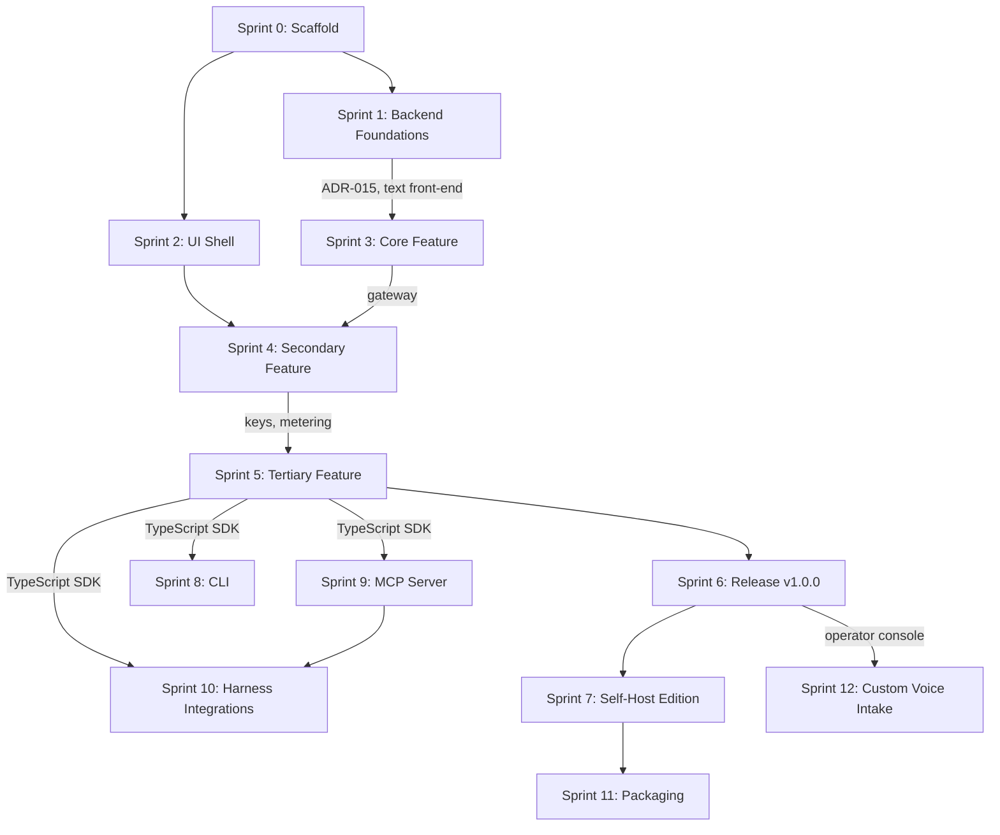

# Yuyin Sprint Plan

**Version:** 0.1.0
**Status:** Draft
**Date:** 2026-11-10

Note: every task below carries `Issue: TBD`. Issue numbers are written back into this file after Step 3 (GitHub issue creation) completes. Sprint dates are computed from the Appendix H durations, starting 2026-11-10, with Due equal to the last day of each sprint. Task IDs, titles, and sizes are taken from the build prompt and must not be renamed.

Priority convention: p0 means the task is directly required by the sprint gate; p1 means it must land in the sprint but is not a gate item; p2 and p3 are used rarely.

---

## Sprint 0: Scaffold

**Milestone:** Sprint 0: Scaffold
**Duration:** 1 week
**Start:** 2026-11-10
**Due:** 2026-11-16
**Goal:** An empty but fully wired monorepo. CI is green, every agent file exists, nothing ships yet.

| ID | Title | Size | Priority |
|---|---|---|---|
| S0-T01 | Monorepo layout | M | p0 |
| S0-T02 | Rust workspace and toolchain | S | p0 |
| S0-T03 | Bun workspace, TypeScript base config, ESLint, Prettier | S | p0 |
| S0-T04 | CI pipeline | L | p0 |
| S0-T05 | Version source of truth and scripts | S | p0 |
| S0-T06 | Agent repository files | M | p0 |
| S0-T07 | Licence and legal files | S | p0 |
| S0-T08 | Local dev stack | M | p0 |
| S0-T09 | OpenAPI skeleton and contract lint | S | p1 |
| S0-T10 | Dependabot, audit jobs, secret scanning | S | p1 |
| S0-T11 | Owner checklist | XS | p1 |
| S0-T12 | Makefile and build entry points | M | p0 |
| S0-T13 | Container skeletons and image build in CI | M | p0 |

### S0-T01: Monorepo layout
- **Issue:** TBD
- **Labels:** type: chore, area: infra, priority: p0, size: M, sprint: 0
- **Estimate:** M
- **Dependencies:** none
- **Spec references:** ARCHITECTURE "Repository layout"; BUILD_PROMPT Appendix B
- **Description:** Create the monorepo tree defined in Appendix B (Rust crates, apps, packages, integrations, deploy, bench, api, docs, scripts, config). Every crate and package compiles with a placeholder implementation and contains one passing test, so later sprints only fill in behaviour.
- **Acceptance criteria:**
  - [ ] The directory tree matches Appendix B
  - [ ] `cargo build --workspace` exits 0 on a clean clone
  - [ ] `bun install && bun run build` exits 0 on a clean clone
  - [ ] Every crate and package has one passing placeholder test
- **Test scenarios to add:** unit_workspace_crates_placeholder_compiles_passes, unit_workspace_packages_placeholder_builds_passes, e2e_repo_cleanclone_build_exits_zero

### S0-T02: Rust workspace and toolchain
- **Issue:** TBD
- **Labels:** type: chore, area: infra, priority: p0, size: S, sprint: 0
- **Estimate:** S
- **Dependencies:** S0-T01
- **Spec references:** ARCHITECTURE "Technology choices"
- **Description:** Add `rust-toolchain.toml` pinned to current stable. Workspace `Cargo.toml` with `[workspace.package]` version, edition 2021 or later, and shared lints: `unsafe_code = "forbid"` everywhere except `yuyin-engine` and `yuyin-audio`, where FFI may need it and the lint is `deny` with documented allows. Add `rustfmt.toml` and `clippy.toml`.
- **Acceptance criteria:**
  - [ ] `cargo fmt --check` exits 0
  - [ ] `cargo clippy --workspace -- -D warnings` exits 0
  - [ ] `unsafe_code` is forbid in all crates except the two named, where it is deny with documented allows
  - [ ] Toolchain version is pinned in `rust-toolchain.toml`
- **Test scenarios to add:** unit_workspace_lints_unsafecode_forbidden_rejectsunsafe, unit_workspace_toolchain_pinned_matchesfile

### S0-T03: Bun workspace, TypeScript base config, ESLint, Prettier
- **Issue:** TBD
- **Labels:** type: chore, area: infra, priority: p0, size: S, sprint: 0
- **Estimate:** S
- **Dependencies:** S0-T01
- **Spec references:** ARCHITECTURE "Technology choices"
- **Description:** Root `package.json` with workspaces `apps/*`, `packages/*`, `integrations/*`. `tsconfig.base.json` with `strict`, `noUncheckedIndexedAccess`, and `exactOptionalPropertyTypes`. ESLint and Prettier configured. Scripts: `lint`, `type-check`, `test`, `build`.
- **Acceptance criteria:**
  - [ ] `bun run lint` exits 0
  - [ ] `bun run type-check` exits 0
  - [ ] `bun run test` exits 0
  - [ ] `bun run build` exits 0
  - [ ] Base tsconfig enables the three strictness flags
- **Test scenarios to add:** unit_tsconfig_base_strictflags_enabled, unit_workspace_scripts_allfour_exitzero

### S0-T04: CI pipeline
- **Issue:** TBD
- **Labels:** type: chore, area: infra, priority: p0, size: L, sprint: 0
- **Estimate:** L
- **Dependencies:** S0-T02, S0-T03
- **Spec references:** ARCHITECTURE "CI and release pipeline"; TEST_PLAN "Coverage thresholds"
- **Description:** Create `.github/workflows/ci.yml` with the jobs: `lint-and-typecheck` (ubuntu amd64 and arm64 runners; fmt, clippy, eslint, tsc), `unit-tests` (needs lint; cargo test, vitest, pytest), `coverage` (needs unit; tarpaulin and vitest coverage, fails under thresholds), `integration-tests` (needs unit; Postgres and Valkey service containers), `contract-tests` (needs unit; OpenAPI lint, SDK type drift check), `e2e-tests` (needs integration; Playwright against local stack), `version-check` (PRs to staging and main; `scripts/check-versions.sh`), `cli-matrix` (macOS, Linux, Windows; builds and smoke-tests the CLI, active from Sprint 8), `harness-smoke-tests` (staging and release only, active from Sprint 10). Jobs for later sprints exist as documented stubs.
- **Acceptance criteria:**
  - [ ] A PR with a deliberate lint error fails CI
  - [ ] A PR that drops coverage under threshold fails CI
  - [ ] Job dependency graph matches the list above
  - [ ] Stub jobs for Sprint 8 and Sprint 10 are present and skipped with a clear message
- **Test scenarios to add:** e2e_ci_lintjob_deliberateerror_failspr, e2e_ci_coveragejob_belowthreshold_failspr, contract_ci_workflow_jobgraph_matchesspec

### S0-T05: Version source of truth and scripts
- **Issue:** TBD
- **Labels:** type: chore, area: infra, priority: p0, size: S, sprint: 0
- **Estimate:** S
- **Dependencies:** S0-T01
- **Spec references:** BUILD_PROMPT "Versioning, Changelog, and Release"; ARCHITECTURE "Versioning"
- **Description:** Root `VERSION` file containing `0.1.0`. Add `scripts/check-versions.sh` and `scripts/extract-changelog.sh` exactly as given in the Versioning section. Add `CHANGELOG.md` with an `[Unreleased]` section.
- **Acceptance criteria:**
  - [ ] `VERSION` contains `0.1.0`
  - [ ] Changing one package version makes `check-versions.sh` exit 1 naming the file
  - [ ] `extract-changelog.sh` extracts the section for a given version
  - [ ] `CHANGELOG.md` has an `[Unreleased]` section
- **Test scenarios to add:** unit_scripts_checkversions_mismatch_exitsonenamesfile, unit_scripts_checkversions_allmatch_exitszero, unit_scripts_extractchangelog_knownversion_returnssection

### S0-T06: Agent repository files
- **Issue:** TBD
- **Labels:** type: docs, area: infra, priority: p0, size: M, sprint: 0
- **Estimate:** M
- **Dependencies:** S0-T01
- **Spec references:** BUILD_PROMPT Appendix J; ARCHITECTURE "Repository layout"
- **Description:** Generate `.gitignore`, `AGENTS.md`, `CLAUDE.md`, `SKILLS.md`, `SOUL.md`, and the skills `.agent/skills/run-tests/{SKILL.md,run.sh}`, `.agent/skills/check-types/{SKILL.md,run.sh}`, `.agent/skills/run-golden/{SKILL.md,run.sh}` (runs the normalisation golden corpus), and `.agent/skills/run-bench/{SKILL.md,run.sh}`. Content requirements are in Appendix J.
- **Acceptance criteria:**
  - [ ] All listed files exist
  - [ ] Each `run.sh` is executable
  - [ ] Each `run.sh` exits 0 on the scaffold
  - [ ] Content satisfies Appendix J
- **Test scenarios to add:** unit_agent_skills_runsh_executable_exitszero, unit_agent_files_required_present_allexist

### S0-T07: Licence and legal files
- **Issue:** TBD
- **Labels:** type: docs, area: legal, priority: p0, size: S, sprint: 0
- **Estimate:** S
- **Dependencies:** S0-T04
- **Spec references:** PRD "Licensing"; ARCHITECTURE "Dependency licence policy"
- **Description:** `LICENSE` (proprietary, all rights reserved, Serverless Ventures LLC, 2026). `EULA.md` for the self-host edition: governing law Texas, venue Williamson County, contact legal@serverlessvc.com, liability cap at trailing 12 months of fees, and a clause reserving the right to change pricing and tiers. `THIRD_PARTY_LICENSES.md` generated by `cargo about` and a licence checker for npm, plus a hand-maintained `MODELS.md` section for model and voice licences. Mark the EULA as a draft needing attorney review. Add the CI job `licence-check`.
- **Acceptance criteria:**
  - [ ] `LICENSE`, `EULA.md`, `THIRD_PARTY_LICENSES.md`, `MODELS.md` exist
  - [ ] EULA is marked as a draft needing attorney review
  - [ ] CI job `licence-check` fails on any dependency with a licence outside the allowlist (MIT, Apache-2.0, BSD-2, BSD-3, ISC, Zlib, Unicode, MPL-2.0 for unmodified use)
- **Test scenarios to add:** e2e_ci_licencecheck_disallowedlicence_fails, e2e_ci_licencecheck_allowlistonly_passes

### S0-T08: Local dev stack
- **Issue:** TBD
- **Labels:** type: chore, area: infra, priority: p0, size: M, sprint: 0
- **Estimate:** M
- **Dependencies:** S0-T01
- **Spec references:** ARCHITECTURE "Local development"
- **Description:** `docker-compose.dev.yml` with Postgres 16, Valkey, and `stripe-mock`. `scripts/dev.sh` starts everything. Commit `.env.development.example`. The placeholder gateway exposes `/healthz`.
- **Acceptance criteria:**
  - [ ] `scripts/dev.sh` brings up the stack
  - [ ] `/healthz` on the placeholder gateway returns 200
  - [ ] `.env.development.example` is committed and contains no real secrets
- **Test scenarios to add:** e2e_devstack_startup_allservices_healthzreturns200, unit_env_example_noSecrets_passesscan

### S0-T09: OpenAPI skeleton and contract lint
- **Issue:** TBD
- **Labels:** type: docs, area: gateway, priority: p1, size: S, sprint: 0
- **Estimate:** S
- **Dependencies:** S0-T04
- **Spec references:** PRD FR-001, FR-003, FR-012, FR-020; ARCHITECTURE "API contract"
- **Description:** `api/openapi.yaml` with every path from the contract stubbed. Lint with Spectral or Redocly in CI. The file is the single source for SDK types and the docs reference.
- **Acceptance criteria:**
  - [ ] Every contract path is present in the file
  - [ ] Lint exits 0 in CI
  - [ ] The file is documented as the single source for SDK types and docs reference
- **Test scenarios to add:** contract_openapi_spec_lint_exitszero, contract_openapi_paths_allcontractpaths_present

### S0-T10: Dependabot, audit jobs, secret scanning
- **Issue:** TBD
- **Labels:** type: security, area: infra, priority: p1, size: S, sprint: 0
- **Estimate:** S
- **Dependencies:** S0-T04
- **Spec references:** ARCHITECTURE "Supply chain"; PRD NFR "Security"
- **Description:** Dependabot for cargo, npm, pip, GitHub Actions, and Docker. `cargo audit` and `cargo deny` in CI. `bun audit` or equivalent. Gitleaks as a pre-commit hook and in CI.
- **Acceptance criteria:**
  - [ ] Dependabot configured for all five ecosystems
  - [ ] `cargo audit` and `cargo deny` run in CI
  - [ ] npm audit equivalent runs in CI
  - [ ] A commit containing a fake `yy_live_` secret is rejected
- **Test scenarios to add:** e2e_secretscan_fakeliveKey_commitrejected, e2e_ci_audit_knownvuln_fails

### S0-T11: Owner checklist
- **Issue:** TBD
- **Labels:** type: docs, area: infra, priority: p1, size: XS, sprint: 0
- **Estimate:** XS
- **Dependencies:** none
- **Spec references:** BUILD_PROMPT "Things only the owner does"
- **Description:** `docs/OWNER_CHECKLIST.md` listing every action only the owner can take, with the sprint by which it is needed: domain registration, name and trademark check, AWS account and region, Clerk application, Nile database, Stripe account and products, Vercel project, npm and PyPI org, GHCR access, pricing decision, voice name approval, and attorney review of legal pages.
- **Acceptance criteria:**
  - [ ] File exists with every item above and a needed-by sprint
  - [ ] File is linked from the README
- **Test scenarios to add:** unit_docs_ownerchecklist_linkedfromreadme_linkresolves

### S0-T12: Makefile and build entry points
- **Issue:** TBD
- **Labels:** type: chore, area: infra, priority: p0, size: M, sprint: 0
- **Estimate:** M
- **Dependencies:** S0-T02, S0-T03, S0-T08
- **Spec references:** BUILD_PROMPT "Build and Deployment"; ARCHITECTURE "Build entry points"
- **Description:** Root `Makefile` with every target listed in the Build and Deployment section. Targets for things that do not exist yet print "available from Sprint N" and exit 0. `make help` is generated from target comments. `make setup` checks prerequisites and reports what is missing.
- **Acceptance criteria:**
  - [ ] In a fresh container, `make setup && make build && make check` exits 0
  - [ ] `make dev` brings up the dev stack
  - [ ] `make help` lists every target from its comments
  - [ ] Unbuilt targets print "available from Sprint N" and exit 0
- **Test scenarios to add:** e2e_make_setupbuildcheck_freshcontainer_exitszero, unit_make_help_alltargets_listed, unit_make_futuretarget_notbuilt_printsavailablemessage

### S0-T13: Container skeletons and image build in CI
- **Issue:** TBD
- **Labels:** type: chore, area: infra, priority: p0, size: M, sprint: 0
- **Estimate:** M
- **Dependencies:** S0-T04, S0-T05, S0-T08
- **Spec references:** BUILD_PROMPT "Build and Deployment" image rules; ARCHITECTURE "Container images"
- **Description:** `deploy/docker/Dockerfile.gateway` (multi-stage with `cargo-chef`, `slim` and `full` targets), `Dockerfile.console`, and `.dockerignore`. OCI labels wired to `VERSION` and the commit. `make image` works for the placeholder gateway. CI builds both architectures on every PR without pushing.
- **Acceptance criteria:**
  - [ ] `docker run` of the placeholder image answers `/healthz`
  - [ ] A test asserts the OCI labels are present and correct
  - [ ] A test asserts the image user is non-root
  - [ ] A test asserts no `.env` file exists in any layer
  - [ ] CI builds linux/amd64 and linux/arm64 on every PR without pushing
- **Test scenarios to add:** e2e_image_gateway_healthz_returns200, security_image_labels_versionandcommit_present, security_image_user_nonroot_asserted, security_image_layers_noenvfile_asserted

### Sprint 0 gate
- [ ] `make setup && make build && make check` passes on a clean clone
- [ ] `make dev` starts the local stack and `make smoke` passes against it
- [ ] `make image` builds for linux/amd64 and linux/arm64 in CI
- [ ] All five spec docs committed and linked from the README
- [ ] CI green on `develop`
- [ ] All agent files present
- [ ] `check-versions.sh` passes
- [ ] Licence check passes
- [ ] Every sprint issue exists on the board

---

## Sprint 1: Backend Foundations

**Milestone:** Sprint 1: Backend Foundations
**Duration:** 1 week
**Start:** 2026-11-17
**Due:** 2026-11-23
**Goal:** Text goes in, correctly normalised and segmented text comes out, and we know which speech engine we are shipping, backed by measurements and a licence review. No network code.

| ID | Title | Size | Priority |
|---|---|---|---|
| S1-T01 | Golden corpus format and runner | M | p0 |
| S1-T02 | Script and language tagging | L | p0 |
| S1-T03 | Number verbalisation, Hindi and English, Indian numbering | L | p0 |
| S1-T04 | Currency | M | p0 |
| S1-T05 | Dates and times | M | p0 |
| S1-T06 | Phone numbers, OTPs, digit strings | M | p0 |
| S1-T07 | Acronym lexicon and overrides | M | p0 |
| S1-T08 | Units, percent, ranges, email, URL | M | p0 |
| S1-T09 | Segmenter with short first segment | M | p0 |
| S1-T10 | Engine bake-off spike and ADR | L | p0 |
| S1-T11 | `SynthesisEngine` trait and fake engine | S | p0 |
| S1-T12 | Property tests and fuzzing for the normaliser | M | p1 |

### S1-T01: Golden corpus format and runner
- **Issue:** TBD
- **Labels:** type: test, area: text, priority: p0, size: M, sprint: 1
- **Estimate:** M
- **Dependencies:** S0-T01
- **Spec references:** PRD FR-006, NFR-011; ARCHITECTURE "Text front-end"; TEST_PLAN "Golden corpus"
- **Description:** Create `crates/yuyin-text/golden/*.tsv` with columns `id`, `lang`, `class`, `input`, `expected`, `notes`. A test harness runs every row. Start with at least 400 rows written by hand across all classes and four languages. Add a `scripts/golden-add.sh` helper.
- **Acceptance criteria:**
  - [ ] Corpus has at least 400 hand-written rows across all classes and four languages
  - [ ] Runner reports per-class pass counts
  - [ ] CI fails on any regression
  - [ ] `scripts/golden-add.sh` appends a validated row
  - [ ] Plan recorded to grow the corpus to 1,500 rows by v1.0.0 (NFR-011)
- **Test scenarios to add:** unit_text_goldenrunner_allrows_passes, unit_text_goldenrunner_regressionrow_failsci, unit_text_goldenrunner_perclassreport_countsprinted

### S1-T02: Script and language tagging
- **Issue:** TBD
- **Labels:** type: feature, area: text, priority: p0, size: L, sprint: 1
- **Estimate:** L
- **Dependencies:** S1-T01
- **Spec references:** PRD FR-004, FR-005; ARCHITECTURE "Language and script tagging"
- **Description:** Per-token script detection from Unicode blocks. Roman Hindi detection with a bundled lexicon (at least 20,000 frequent romanised Hindi word forms, sourced from data with a permissive licence, licence recorded) plus a character n-gram scorer for unknown words. `language: "auto"` infers the sentence-level matrix language. An explicit `language` constrains the tagger.
- **Acceptance criteria:**
  - [ ] At least 95% token-level accuracy on a held-out set of 2,000 hand-labelled Hinglish tokens in `tests/data/tagging/`
  - [ ] Lexicon has at least 20,000 romanised Hindi forms with licence recorded
  - [ ] `language: "auto"` infers a sentence-level matrix language
  - [ ] An explicit `language` constrains the tagger
- **Test scenarios to add:** unit_text_tagger_devanagari_tokenstaggedhindi, unit_text_tagger_romanhindi_lexiconhit_taggedhindi, unit_text_tagger_unknownword_ngramscorer_classified, unit_text_tagger_heldoutset_accuracyatleast95pct, unit_text_tagger_explicitlanguage_constrainsoutput

### S1-T03: Number verbalisation, Hindi and English, Indian numbering
- **Issue:** TBD
- **Labels:** type: feature, area: text, priority: p0, size: L, sprint: 1
- **Estimate:** L
- **Dependencies:** S1-T01
- **Spec references:** PRD FR-006; ARCHITECTURE "Normalisation: numbers"
- **Description:** Cardinals to 10^15, ordinals, decimals, negatives, and fractions. Hindi forms for 0 to 99 are irregular and must be a lookup table, not a rule. Indian grouping (lakh, crore, arab) for hi, hinglish, and en-IN. Western grouping (million, billion) for en-US.
- **Acceptance criteria:**
  - [ ] Golden rows for every integer 0 to 100 in Hindi
  - [ ] Golden rows for boundary values
  - [ ] 100 random values pass a round-trip property test (verbalise then parse)
  - [ ] Indian grouping used for hi, hinglish, en-IN; Western grouping for en-US
- **Test scenarios to add:** unit_text_numbers_hindi0to99_tablelookup_matchesgolden, unit_text_numbers_indiangrouping_lakhcrore_verbalised, unit_text_numbers_westerngrouping_enus_million, property_text_numbers_roundtrip_100values_parsebackequal

### S1-T04: Currency
- **Issue:** TBD
- **Labels:** type: feature, area: text, priority: p0, size: M, sprint: 1
- **Estimate:** M
- **Dependencies:** S1-T03
- **Spec references:** PRD FR-007; ARCHITECTURE "Normalisation: currency"
- **Description:** Handle `₹`, `Rs`, `Rs.`, `INR`, `रु`, `$`, and `USD`. Support paise and cents and forms such as "₹1.5 lakh", "₹2 Cr", and "Rs 12,450/-".
- **Acceptance criteria:**
  - [ ] 120 golden rows pass
  - [ ] All listed symbols and codes are recognised
  - [ ] Paise and cents are read correctly
  - [ ] "₹1.5 lakh", "₹2 Cr", and "Rs 12,450/-" produce the expected spoken form
- **Test scenarios to add:** unit_text_currency_rupeesymbol_spoken_matchesgolden, unit_text_currency_paise_fractionalamount_verbalised, unit_text_currency_lakhcroreshorthand_expanded, unit_text_currency_trailingslashdash_ignored

### S1-T05: Dates and times
- **Issue:** TBD
- **Labels:** type: feature, area: text, priority: p0, size: M, sprint: 1
- **Estimate:** M
- **Dependencies:** S1-T03
- **Spec references:** PRD FR-008; ARCHITECTURE "Normalisation: dates and times"
- **Description:** Numeric dates per the locale rule in the ARCHITECTURE spec, month names in both languages, relative formats left untouched, 12 and 24 hour times ("5:30 PM", "17:30 hrs"), and durations.
- **Acceptance criteria:**
  - [ ] 120 golden rows pass
  - [ ] An ambiguity test proves 05/12/2026 reads as 5 December for en-IN and May 12 for en-US
  - [ ] Relative formats are left untouched
- **Test scenarios to add:** unit_text_dates_ambiguousnumeric_enin_readsdaymonth, unit_text_dates_ambiguousnumeric_enus_readsmonthday, unit_text_times_24hourhrs_verbalised, unit_text_dates_relativeformat_leftuntouched

### S1-T06: Phone numbers, OTPs, digit strings
- **Issue:** TBD
- **Labels:** type: feature, area: text, priority: p0, size: M, sprint: 1
- **Estimate:** M
- **Dependencies:** S1-T03
- **Spec references:** PRD FR-009; ARCHITECTURE "Normalisation: digit strings"
- **Description:** Digit-string rules as specified. Card and account tails ("ending 4417", "XXXX1234"), PIN codes (6-digit Indian postal codes read digit by digit when preceded by "PIN" or "पिन कोड"), and Aadhaar-like and PAN-like patterns read character by character.
- **Acceptance criteria:**
  - [ ] 150 golden rows pass
  - [ ] Negative cases (years, quantities) are not read digit by digit
  - [ ] PIN codes are read digit by digit only when preceded by "PIN" or "पिन कोड"
- **Test scenarios to add:** unit_text_digits_otp_readdigitbydigit, unit_text_digits_cardtail_xxxxprefix_readcorrectly, unit_text_digits_year_negativecase_readasnumber, unit_text_digits_pincode_withprefix_readbydigit, unit_text_digits_panlike_readcharbychar

### S1-T07: Acronym lexicon and overrides
- **Issue:** TBD
- **Labels:** type: feature, area: text, priority: p0, size: M, sprint: 1
- **Estimate:** M
- **Dependencies:** S1-T01
- **Spec references:** PRD FR-010; ARCHITECTURE "Normalisation: acronyms"
- **Description:** Built-in lexicon of at least 300 entries for banking, insurance, telecom, and government terms. Per-tenant overrides are passed in as a parameter (the crate performs no I/O). Unknown all-caps tokens of 2 to 5 letters default to letter-by-letter.
- **Acceptance criteria:**
  - [ ] Lexicon has at least 300 entries
  - [ ] Override precedence test passes (tenant override beats built-in)
  - [ ] Unknown all-caps tokens of 2 to 5 letters default to letter-by-letter
  - [ ] The crate performs no I/O
- **Test scenarios to add:** unit_text_acronyms_override_tenantprecedence_beatsbuiltin, unit_text_acronyms_unknowncaps_2to5letters_letterbyletter, unit_text_acronyms_builtin_emikycupi_readcorrectly

### S1-T08: Units, percent, ranges, email, URL
- **Issue:** TBD
- **Labels:** type: feature, area: text, priority: p0, size: M, sprint: 1
- **Estimate:** M
- **Dependencies:** S1-T03
- **Spec references:** PRD FR-011; ARCHITECTURE "Normalisation: other classes"
- **Description:** Units (kg, km, GB, Mbps, %), ranges ("10-15 days"), emails, and URLs (spoken form with "dot" and "slash").
- **Acceptance criteria:**
  - [ ] 100 golden rows pass
  - [ ] Units, percent, ranges, emails, and URLs are each covered
  - [ ] URL and email spoken forms use "dot" and "slash" as specified
- **Test scenarios to add:** unit_text_units_mbps_expandedcorrectly, unit_text_ranges_daysrange_readasrange, unit_text_email_atdot_spokenform, unit_text_url_slashdot_spokenform

### S1-T09: Segmenter with short first segment
- **Issue:** TBD
- **Labels:** type: feature, area: text, priority: p0, size: M, sprint: 1
- **Estimate:** M
- **Dependencies:** S1-T02, S1-T03
- **Spec references:** PRD FR-001; ARCHITECTURE "Segmentation"
- **Description:** Split on sentence and clause punctuation in both scripts, including the danda `।`. The first segment is capped at about 60 code points by splitting on the earliest safe boundary. Later segments are capped at about 200. Each segment records its span in the original text for billing.
- **Acceptance criteria:**
  - [ ] The union of spans covers the input exactly with no overlap (property test)
  - [ ] No segment splits inside a semiotic span
  - [ ] First segment is capped near 60 code points, later segments near 200
  - [ ] Danda `।` is treated as a sentence boundary
- **Test scenarios to add:** property_text_segmenter_spans_coverinputexactly_nooverlap, unit_text_segmenter_firstsegment_capped60_earliestboundary, unit_text_segmenter_danda_splitsatsentence, unit_text_segmenter_semioticspan_neversplit

### S1-T10: Engine bake-off spike and ADR
- **Issue:** TBD
- **Labels:** type: spike, area: engine, priority: p0, size: L, sprint: 1
- **Estimate:** L
- **Dependencies:** S0-T01
- **Spec references:** PRD FR-003, FR-004, NFR-001, NFR-002; ARCHITECTURE "Synthesis engine"
- **Description:** Time box of 3 days. Evaluate at least three open-weights TTS options that can run on CPU through ONNX Runtime or an equivalent permissively licensed runtime. Start from the candidate list (Kokoro-family models, VITS-family voices such as those distributed for Piper, Matcha-TTS-family models, each through a runtime such as sherpa-onnx or the `ort` crate directly) and add any better option found at implementation time. For each candidate record: licence of the code, weights, each voice, and the phonemiser, with links (reject anything that does not clearly allow commercial hosted use and redistribution inside a container image, and watch for GPL phonemisers and non-commercial training data); languages and voices for Hindi, Indian English, US English; whether chunked or incremental output inside a segment is supported; measured real-time factor, time to first audio for a 60-character segment, peak memory, and load time on a 4 vCPU x86 and a 4 vCPU ARM instance; and a 20-utterance listening sample per language. Write `docs/adr/ADR-015-engine-selection.md` with the table, the choice, and the fallback. If no candidate has an acceptable Hindi voice with a clean licence, stop and raise a `status: needs-owner` issue. Do not ship a voice with unclear rights.
- **Acceptance criteria:**
  - [ ] ADR-015 merged with the table, the choice, and the fallback
  - [ ] Benchmark scripts committed under `bench/engine-bakeoff/`
  - [ ] Licence evidence saved in `docs/licences/`
  - [ ] At least three candidates evaluated with all recorded measurements on x86 and ARM
  - [ ] 20-utterance listening sample per language produced
  - [ ] If no licence-clean Hindi voice exists, a `status: needs-owner` issue is raised
- **Test scenarios to add:** unit_bench_bakeoff_script_runsonfakeinput_producesreport, unit_docs_licences_voiceentries_evidencefilepresent

### S1-T11: `SynthesisEngine` trait and fake engine
- **Issue:** TBD
- **Labels:** type: feature, area: engine, priority: p0, size: S, sprint: 1
- **Estimate:** S
- **Dependencies:** S0-T02
- **Spec references:** ARCHITECTURE "SynthesisEngine trait"; TEST_PLAN "FakeEngine"
- **Description:** Implement the trait as in the ARCHITECTURE spec. `FakeEngine` generates a deterministic sine sweep whose length is proportional to text length, with a configurable delay, for use in every test above the engine layer.
- **Acceptance criteria:**
  - [ ] Trait compiles
  - [ ] `FakeEngine` has tests and is deterministic
  - [ ] Cancellation stops synthesis within 20 ms
  - [ ] Output length is proportional to text length with a configurable delay
- **Test scenarios to add:** unit_engine_fakeengine_synthesise_deterministicoutput, unit_engine_fakeengine_cancel_stopswithin20ms, unit_engine_fakeengine_textlength_proportionalduration

### S1-T12: Property tests and fuzzing for the normaliser
- **Issue:** TBD
- **Labels:** type: test, area: text, priority: p1, size: M, sprint: 1
- **Estimate:** M
- **Dependencies:** S1-T03, S1-T04, S1-T05, S1-T06, S1-T07, S1-T08, S1-T09
- **Spec references:** TEST_PLAN "Property and fuzz tests"; PRD NFR-011
- **Description:** `proptest` for invariants: never panics on arbitrary Unicode, output is deterministic, output contains no ASCII digits when `normalize = true`, and span coverage is exact. Add a `cargo fuzz` target with a 10 minute CI budget on a weekly schedule.
- **Acceptance criteria:**
  - [ ] Properties pass with 10,000 cases each
  - [ ] `cargo fuzz` target runs weekly with a 10 minute budget
  - [ ] No panic on arbitrary Unicode input
- **Test scenarios to add:** property_text_normalise_arbitraryunicode_neverpanics, property_text_normalise_sameinput_deterministicoutput, property_text_normalise_normalizetrue_noasciidigits, property_text_segmenter_anyinput_spancoverageexact

### Sprint 1 gate
- [ ] Golden corpus at least 400 rows, 100% pass
- [ ] `yuyin-text` coverage at least 92%
- [ ] Tagging accuracy target met
- [ ] ADR-015 merged with a licence-clean engine choice, or an owner issue raised
- [ ] No network or file I/O in `yuyin-text` (enforced by a dependency check)

---

## Sprint 2: UI Shell

**Milestone:** Sprint 2: UI Shell
**Duration:** 1 week
**Start:** 2026-11-24
**Due:** 2026-11-30
**Goal:** The design system exists and every screen is navigable with mock data. Nothing is wired to real services except Clerk sign-in.

| ID | Title | Size | Priority |
|---|---|---|---|
| S2-T01 | Next.js app, Tailwind tokens, fonts | M | p0 |
| S2-T02 | Component library | L | p0 |
| S2-T03 | Signature element: the pulse line | M | p1 |
| S2-T04 | Clerk auth and organization switcher | M | p0 |
| S2-T05 | Console screens with mock data | L | p0 |
| S2-T06 | Marketing site shell | M | p0 |
| S2-T07 | Docs site shell | M | p1 |
| S2-T08 | Accessibility and Devanagari rendering checks | S | p0 |
| S2-T09 | Playwright harness and visual snapshots | M | p0 |

### S2-T01: Next.js app, Tailwind tokens, fonts
- **Issue:** TBD
- **Labels:** type: feature, area: console, priority: p0, size: M, sprint: 2
- **Estimate:** M
- **Dependencies:** S0-T03
- **Spec references:** DESIGN "Design System"; ARCHITECTURE "Console"
- **Description:** Next.js App Router with strict TypeScript. Tailwind configured with the tokens from the Design System section expressed as CSS variables, dark theme default with a light theme. Self-host the fonts. Route groups: `(marketing)`, `(console)`, `(operator)`.
- **Acceptance criteria:**
  - [ ] Lighthouse performance at least 90 on the home shell
  - [ ] Lighthouse accessibility at least 95 on the home shell
  - [ ] Design tokens are CSS variables; no raw colour, type, or spacing values elsewhere
  - [ ] Fonts are self-hosted
  - [ ] Route groups `(marketing)`, `(console)`, `(operator)` exist
- **Test scenarios to add:** e2e_console_homeshell_lighthouse_meetsthresholds, unit_console_tokens_themes_darkdefaultlightavailable, unit_console_styles_rawvalues_lintrejects

### S2-T02: Component library
- **Issue:** TBD
- **Labels:** type: feature, area: console, priority: p0, size: L, sprint: 2
- **Estimate:** L
- **Dependencies:** S2-T01
- **Spec references:** DESIGN "Components"; PRD FR-022
- **Description:** Build Button, Input, Textarea (with a code point counter that counts the same way as the gateway), Select, VoicePicker, Table, Tabs, Dialog, Toast, Badge, CodeBlock with copy and language tabs (curl, TypeScript, Python), KeyReveal (shows a secret once), BalanceMeter, UsageChart, EmptyState, and ErrorState. Each has a Storybook story or an equivalent preview route and a unit test.
- **Acceptance criteria:**
  - [ ] Every listed component exists with a story or preview route
  - [ ] Every component has a unit test
  - [ ] Every component has keyboard support and a visible focus ring
  - [ ] Textarea counter counts Unicode code points
  - [ ] KeyReveal shows a secret exactly once
- **Test scenarios to add:** unit_console_textarea_counter_codepoints_matchesexpected, unit_console_keyreveal_secret_shownonce, unit_console_components_keyboardnav_focusringvisible, unit_console_codeblock_copy_languagetabswork

### S2-T03: Signature element: the pulse line
- **Issue:** TBD
- **Labels:** type: feature, area: console, priority: p1, size: M, sprint: 2
- **Estimate:** M
- **Dependencies:** S2-T01
- **Spec references:** DESIGN "Signature element"; PRD FR-022
- **Description:** The pulse line component described in the Design System section, driven by a mock audio stream.
- **Acceptance criteria:**
  - [ ] Renders at 60 fps on a mid-range laptop
  - [ ] Respects `prefers-reduced-motion`
  - [ ] Has an accessible text alternative
- **Test scenarios to add:** unit_console_pulseline_reducedmotion_staticrender, unit_console_pulseline_render_hasaccessibletextalternative, perf_console_pulseline_mockstream_sustains60fps

### S2-T04: Clerk auth and organization switcher
- **Issue:** TBD
- **Labels:** type: feature, area: console, priority: p0, size: M, sprint: 2
- **Estimate:** M
- **Dependencies:** S2-T01
- **Spec references:** PRD FR-021; ARCHITECTURE "Authentication and roles"
- **Description:** Clerk sign-up, sign-in, email verification, and organizations, with roles mapped to owner, admin, developer, billing. Middleware protects `(console)` and `(operator)`. Operator access is an allowlist of Clerk user ids from the environment.
- **Acceptance criteria:**
  - [ ] An e2e test covers sign-up to first console view using Clerk test mode
  - [ ] Roles map to owner, admin, developer, billing
  - [ ] Unauthenticated requests to `(console)` and `(operator)` are redirected
  - [ ] Operator routes are accessible only to the env-configured allowlist
- **Test scenarios to add:** e2e_console_signup_firstconsoleview_succeeds, security_console_operatorroute_nonallowlisted_denied, security_console_middleware_unauthenticated_redirects

### S2-T05: Console screens with mock data
- **Issue:** TBD
- **Labels:** type: feature, area: console, priority: p0, size: L, sprint: 2
- **Estimate:** L
- **Dependencies:** S2-T02, S2-T04
- **Spec references:** DESIGN "Screens"; PRD FR-015, FR-016, FR-020, FR-022, FR-026
- **Description:** Implement all console screens from DESIGN.md, backed by a typed mock data layer behind the same interfaces the real data layer will implement.
- **Acceptance criteria:**
  - [ ] Every screen in DESIGN.md is reachable
  - [ ] Every empty and error state is viewable through a query flag
  - [ ] The mock data layer implements the same TypeScript interfaces as the planned real layer
- **Test scenarios to add:** e2e_console_screens_all_reachable, e2e_console_screens_emptystateflag_renders, e2e_console_screens_errorstateflag_renders

### S2-T06: Marketing site shell
- **Issue:** TBD
- **Labels:** type: feature, area: site, priority: p0, size: M, sprint: 2
- **Estimate:** M
- **Dependencies:** S2-T01, S2-T02
- **Spec references:** PRD FR-023; DESIGN "Marketing site"
- **Description:** Home with a demo panel (mock), Pricing (reads `config/pricing.toml`), Benchmarks page (placeholder stating numbers will be published from the harness), Custom voice, FAQ, About, Contact, and legal page stubs. All copy is original. No performance claims.
- **Acceptance criteria:**
  - [ ] No page contains a latency or capacity number
  - [ ] Pricing reads `config/pricing.toml`
  - [ ] All listed pages exist
  - [ ] Benchmarks page states numbers will be published from the harness
- **Test scenarios to add:** unit_site_pages_allpublic_noperformancenumbers, unit_site_pricing_configfile_rendersvalues, e2e_site_pages_alllisted_navigable

### S2-T07: Docs site shell
- **Issue:** TBD
- **Labels:** type: feature, area: docs-site, priority: p1, size: M, sprint: 2
- **Estimate:** M
- **Dependencies:** S2-T01, S0-T09
- **Spec references:** PRD FR-024; DESIGN "Docs site"
- **Description:** Docs site with MDX, sidebar, search, and an API reference generated from `api/openapi.yaml`.
- **Acceptance criteria:**
  - [ ] Reference page builds from the OpenAPI file in CI
  - [ ] Sidebar and search work
  - [ ] MDX pages render
- **Test scenarios to add:** contract_docs_reference_buildfromopenapi_succeeds, e2e_docs_search_knownterm_returnsresult

### S2-T08: Accessibility and Devanagari rendering checks
- **Issue:** TBD
- **Labels:** type: test, area: console, priority: p0, size: S, sprint: 2
- **Estimate:** S
- **Dependencies:** S2-T05, S2-T06, S2-T09
- **Spec references:** DESIGN "Accessibility"; TEST_PLAN "Accessibility"
- **Description:** Run axe checks in Playwright on every route. Add a fixture page that renders 50 Devanagari strings with conjuncts and matras, snapshot-tested.
- **Acceptance criteria:**
  - [ ] Zero serious or critical axe violations on every route
  - [ ] Devanagari fixture page with 50 strings is snapshot-tested
- **Test scenarios to add:** e2e_a11y_allroutes_axe_zeroseriousviolations, e2e_render_devanagarifixture_conjunctsmatras_matchessnapshot

### S2-T09: Playwright harness and visual snapshots
- **Issue:** TBD
- **Labels:** type: test, area: console, priority: p0, size: M, sprint: 2
- **Estimate:** M
- **Dependencies:** S2-T05
- **Spec references:** TEST_PLAN "End-to-end and visual tests"
- **Description:** Playwright config, auth fixture, and visual snapshots for 12 key screens in both themes.
- **Acceptance criteria:**
  - [ ] 12 key screens have snapshots in both themes
  - [ ] Auth fixture works with Clerk test mode
  - [ ] The suite runs in CI in under 6 minutes
- **Test scenarios to add:** e2e_visual_keyscreens_darktheme_matchessnapshots, e2e_visual_keyscreens_lighttheme_matchessnapshots

### Sprint 2 gate
- [ ] Every screen in DESIGN.md exists and is navigable
- [ ] Design tokens are the only source of colour, type, and spacing values
- [ ] Zero serious accessibility violations
- [ ] Visual snapshots committed

---

## Sprint 3: Core Feature

**Milestone:** Sprint 3: Core Feature
**Duration:** 2 weeks
**Start:** 2026-12-01
**Due:** 2026-12-14
**Goal:** The feature that IS the product. A curl command with a real key placeholder returns audio that starts playing while synthesis is still running, over REST and over WebSocket, with honest overload behaviour.

| ID | Title | Size | Priority |
|---|---|---|---|
| S3-T01 | ONNX engine implementation | XL | p0 |
| S3-T02 | Voice registry and `config/voices.toml` | M | p0 |
| S3-T03 | Worker pool and per-stream pipeline | L | p0 |
| S3-T04 | Opus encoder and Ogg muxer | L | p0 |
| S3-T05 | PCM and WAV outputs | S | p0 |
| S3-T06 | Pace control | M | p1 |
| S3-T07 | REST endpoint `POST /v1/speech` | L | p0 |
| S3-T08 | WebSocket endpoint | L | p0 |
| S3-T09 | Admission control and 503 behaviour | M | p0 |
| S3-T10 | Graceful draining | M | p0 |
| S3-T11 | Voices and normalise endpoints | S | p1 |
| S3-T12 | Metrics, tracing, structured logs | M | p0 |
| S3-T13 | Benchmark harness v1 and capacity file | L | p0 |
| S3-T14 | Static dev key auth shim | XS | p1 |
| S3-T15 | Listening sheet generator | S | p0 |
| S3-T16 | Gateway image with models and `healthcheck` subcommand | M | p0 |
| S3-T17 | Minimal Helm chart and kind install in CI | L | p0 |

### S3-T01: ONNX engine implementation
- **Issue:** TBD
- **Labels:** type: feature, area: engine, priority: p0, size: XL, sprint: 3
- **Estimate:** XL
- **Dependencies:** S1-T10, S1-T11, S1-T09
- **Spec references:** PRD FR-004, FR-014, NFR-001, NFR-002; ARCHITECTURE "Synthesis engine"; ADR-015
- **Description:** Implement `SynthesisEngine` for the engine chosen in ADR-015. Load models from `YUYIN_MODEL_DIR`. Use one session per voice or a shared session with speaker embeddings, whichever the model supports. Intra-op threads 1, inter-op 1. Phonemisation goes through the licence-approved front-end from the ADR. Emit PCM in chunks as soon as the model yields them. If the model cannot yield inside a segment, the short-first-segment rule is what delivers low time to first audio, and the spec must say so. Verify model file checksums at load.
- **Acceptance criteria:**
  - [ ] Synthesises all four languages
  - [ ] `warmup()` runs one utterance per voice
  - [ ] A corrupt model file fails startup with a clear error and a non-zero exit
  - [ ] Model checksums are verified at load
  - [ ] Intra-op and inter-op threads are 1
  - [ ] ARCHITECTURE states whether incremental output inside a segment is supported
- **Test scenarios to add:** integration_engine_onnx_fourlanguages_producesaudio, integration_engine_onnx_warmup_onevoiceutteranceeach, integration_engine_onnx_corruptmodel_startupfailsnonzero, unit_engine_onnx_checksum_mismatch_rejectsmodel

### S3-T02: Voice registry and `config/voices.toml`
- **Issue:** TBD
- **Labels:** type: feature, area: engine, priority: p0, size: M, sprint: 3
- **Estimate:** M
- **Dependencies:** S1-T10
- **Spec references:** PRD FR-003; ARCHITECTURE "Voice registry"
- **Description:** `config/voices.toml` lists id, display name, engine voice reference, languages, gender, style, licence reference, and sample text. Voice ids are stable slugs. Display names are original Indian and English first names proposed by the agent and approved by the owner. Ship only voices that passed the licence review. The v1 target is at least 6 public voices covering all four languages. Do not pad the catalogue with near-duplicates.
- **Acceptance criteria:**
  - [ ] Every voice has a `licence_ref` that resolves to a file in `docs/licences/`
  - [ ] CI fails if a `licence_ref` does not resolve
  - [ ] At least 6 public voices covering all four languages, with no near-duplicates
  - [ ] Display names are marked pending owner approval until approved
- **Test scenarios to add:** unit_engine_voiceregistry_missinglicenceref_ciFails, unit_engine_voiceregistry_load_allvoicesparsed, unit_engine_voiceregistry_ids_stableslugs

### S3-T03: Worker pool and per-stream pipeline
- **Issue:** TBD
- **Labels:** type: feature, area: gateway, priority: p0, size: L, sprint: 3
- **Estimate:** L
- **Dependencies:** S1-T09, S1-T11, S3-T04
- **Spec references:** PRD NFR-004; ARCHITECTURE "Streaming pipeline"
- **Description:** Per request: normalise and segment, enqueue segments to the worker pool, receive PCM over a bounded channel, encode, and write. Workers are dedicated OS threads pinned to the configured core count. Cancellation propagates when the client disconnects. A panicking worker is caught, the stream ends with an error event, and the worker is replaced.
- **Acceptance criteria:**
  - [ ] With `FakeEngine`, 200 concurrent streams complete with no cross-talk (each stream's audio matches its expected deterministic signal)
  - [ ] Client disconnect cancels synthesis
  - [ ] A panicking worker ends its stream with an error event and is replaced
  - [ ] Workers are dedicated OS threads pinned to the configured core count
- **Test scenarios to add:** integration_gateway_pipeline_200concurrent_nocrosstalk, integration_gateway_pipeline_clientdisconnect_cancelssynthesis, integration_gateway_pipeline_workerpanic_errorEventAndReplacement

### S3-T04: Opus encoder and Ogg muxer
- **Issue:** TBD
- **Labels:** type: feature, area: audio, priority: p0, size: L, sprint: 3
- **Estimate:** L
- **Dependencies:** S0-T02
- **Spec references:** PRD FR-014; ARCHITECTURE "Audio encoding"
- **Description:** Opus at 24 kHz mono, 20 ms frames, default 32 kbps, with Ogg pages flushed at least every 100 ms so players can start early. For WebSocket, send Ogg pages as binary frames (document this, and offer `format: "opus_raw"` as a non-default option only if the spec decides so).
- **Acceptance criteria:**
  - [ ] Output plays in Chrome, Firefox, Safari, ffplay, and VLC
  - [ ] An integration test decodes the stream with a reference decoder and checks duration within 2%
  - [ ] Ogg pages are flushed at least every 100 ms
  - [ ] WebSocket binary frame behaviour is documented
- **Test scenarios to add:** integration_audio_opus_referencedecoder_durationwithin2pct, unit_audio_ogg_pageflush_atmost100msinterval, e2e_audio_opus_browsersandplayers_plays

### S3-T05: PCM and WAV outputs
- **Issue:** TBD
- **Labels:** type: feature, area: audio, priority: p0, size: S, sprint: 3
- **Estimate:** S
- **Dependencies:** S0-T02
- **Spec references:** PRD FR-014; ARCHITECTURE "Audio encoding"
- **Description:** PCM is s16le. WAV over a stream uses a header with the data length set to the maximum value, and documents that behaviour.
- **Acceptance criteria:**
  - [ ] Output decodes in ffmpeg
  - [ ] Output decodes in the browser Web Audio API
  - [ ] Streamed WAV header behaviour is documented
- **Test scenarios to add:** integration_audio_wav_ffmpegdecode_succeeds, e2e_audio_pcm_webaudio_decodesandplays, unit_audio_wav_streamheader_maxdatalength

### S3-T06: Pace control
- **Issue:** TBD
- **Labels:** type: feature, area: audio, priority: p1, size: M, sprint: 3
- **Estimate:** M
- **Dependencies:** S3-T01
- **Spec references:** PRD FR-013; ARCHITECTURE "Pace control"
- **Description:** Prefer the model's native duration or length-scale control. Where the model has none, use a pitch-preserving time-stretch (WSOLA) in `yuyin-audio`. Range 0.5 to 2.0, clamped and validated.
- **Acceptance criteria:**
  - [ ] Measured output duration is within 5% of `baseline / pace` across the range
  - [ ] Pitch shift is under 1% (measured on a test tone path for the time-stretch implementation)
  - [ ] Out-of-range pace is clamped or rejected per the contract
- **Test scenarios to add:** unit_audio_pace_range_durationwithin5pct, unit_audio_wsola_testtone_pitchshiftunder1pct, unit_audio_pace_outofrange_validatedperspec

### S3-T07: REST endpoint `POST /v1/speech`
- **Issue:** TBD
- **Labels:** type: feature, area: gateway, priority: p0, size: L, sprint: 3
- **Estimate:** L
- **Dependencies:** S3-T03, S3-T04, S3-T05, S3-T14, S0-T09
- **Spec references:** PRD FR-001, FR-019; ARCHITECTURE "REST protocol"; API contract
- **Description:** Implement as in the contract. The status line and headers are sent only after admission succeeds and the first audio chunk is ready or 300 ms have passed, whichever is first, so pre-audio failures can still return a proper error status. Trailers carry billed characters and time to first audio.
- **Acceptance criteria:**
  - [ ] Scenario tests exist for every error code
  - [ ] `curl --no-buffer` shows bytes arriving before synthesis completes for a 1,000 character input
  - [ ] Headers are sent only after admission and first chunk or 300 ms
  - [ ] Trailers carry billed characters and time to first audio
- **Test scenarios to add:** integration_gateway_speech_longinput_bytesarriveBeforeCompletion, integration_gateway_speech_eachErrorCode_returnsContractedResponse, integration_gateway_speech_trailers_billedcharsandttfapresent

### S3-T08: WebSocket endpoint
- **Issue:** TBD
- **Labels:** type: feature, area: gateway, priority: p0, size: L, sprint: 3
- **Estimate:** L
- **Dependencies:** S3-T03, S3-T04, S3-T14
- **Spec references:** PRD FR-002; ARCHITECTURE "WebSocket protocol"
- **Description:** Protocol as in the contract. Incoming text is buffered until a segment boundary or `flush`. Supports LLM-style token streaming: partial words are held until whitespace or punctuation arrives. Backpressure: if the client stops reading, synthesis for that stream pauses, and after 30 s the stream is closed.
- **Acceptance criteria:**
  - [ ] A test client that sends one word every 50 ms hears continuous speech with no gap longer than 400 ms beyond what the text timing implies (measured on `FakeEngine`)
  - [ ] Partial words are held until whitespace or punctuation
  - [ ] Backpressure pauses synthesis and closes the stream after 30 s
  - [ ] `flush` forces synthesis of buffered text
- **Test scenarios to add:** integration_gateway_ws_wordevery50ms_nogapover400ms, integration_gateway_ws_partialword_heldUntilBoundary, integration_gateway_ws_clientstopsreading_closesafter30s, integration_gateway_ws_flush_synthesisesbufferedtext

### S3-T09: Admission control and 503 behaviour
- **Issue:** TBD
- **Labels:** type: feature, area: gateway, priority: p0, size: M, sprint: 3
- **Estimate:** M
- **Dependencies:** S3-T03, S3-T07
- **Spec references:** PRD FR-019, NFR-004; ARCHITECTURE "Admission control"
- **Description:** Admission as specified. `capacity_streams` is loaded from `config/capacity.toml` keyed by instance class, overridable by env.
- **Acceptance criteria:**
  - [ ] At capacity, the next request gets 503 with `Retry-After` and zero audio bytes
  - [ ] Active streams finish with byte-identical output to an unloaded run on `FakeEngine`
  - [ ] `capacity_streams` is read from `config/capacity.toml` and overridable by env
- **Test scenarios to add:** integration_gateway_admission_atcapacity_503withretryafterzerobytes, integration_gateway_admission_atcapacity_activestreamsbyteidentical, unit_gateway_admission_envoverride_replacesconfigvalue

### S3-T10: Graceful draining
- **Issue:** TBD
- **Labels:** type: feature, area: gateway, priority: p0, size: M, sprint: 3
- **Estimate:** M
- **Dependencies:** S3-T03, S3-T07
- **Spec references:** PRD NFR-004; ARCHITECTURE "Draining"
- **Description:** SIGTERM handling as specified. `/readyz` returns 503 while draining.
- **Acceptance criteria:**
  - [ ] An integration test sends SIGTERM during 20 active streams
  - [ ] All 20 streams complete
  - [ ] New requests are refused while draining
  - [ ] The process exits 0
  - [ ] `/readyz` returns 503 while draining
- **Test scenarios to add:** integration_gateway_drain_sigtermduring20streams_allcomplete, integration_gateway_drain_newrequest_refused, integration_gateway_drain_readyz_returns503

### S3-T11: Voices and normalise endpoints
- **Issue:** TBD
- **Labels:** type: feature, area: gateway, priority: p1, size: S, sprint: 3
- **Estimate:** S
- **Dependencies:** S3-T02, S1-T08, S0-T09
- **Spec references:** PRD FR-003, FR-012; API contract
- **Description:** `GET /v1/voices`, `GET /v1/voices/{id}`, and `POST /v1/normalize` (rate limited to 60 per minute per key, never billed).
- **Acceptance criteria:**
  - [ ] Contract tests pass against `api/openapi.yaml`
  - [ ] `POST /v1/normalize` is limited to 60 per minute per key
  - [ ] `POST /v1/normalize` is never billed
- **Test scenarios to add:** contract_gateway_voices_list_matchesopenapi, contract_gateway_normalize_request_matchesopenapi, integration_gateway_normalize_61stcallinminute_rejected429

### S3-T12: Metrics, tracing, structured logs
- **Issue:** TBD
- **Labels:** type: feature, area: gateway, priority: p0, size: M, sprint: 3
- **Estimate:** M
- **Dependencies:** S3-T03, S3-T07
- **Spec references:** PRD NFR-007; ARCHITECTURE "Observability"
- **Description:** Prometheus metrics: `yuyin_active_streams`, `yuyin_capacity_streams`, `yuyin_ttfa_seconds` (histogram, by voice and format), `yuyin_rtf` (histogram), `yuyin_requests_total` (by status and code), `yuyin_chars_total`, `yuyin_rejected_total` (by reason), `yuyin_worker_queue_depth`. OpenTelemetry traces with spans for normalise, queue wait, synthesis, and encode. JSON logs with request id. Logs never contain request text unless `YUYIN_DEBUG_LOG_TEXT=true`, which is refused in the prod profile.
- **Acceptance criteria:**
  - [ ] A test asserts that no log line at info level contains the submitted text
  - [ ] All listed metrics are exported with the stated labels
  - [ ] Traces include spans for normalise, queue wait, synthesis, encode
  - [ ] `YUYIN_DEBUG_LOG_TEXT=true` is refused in the prod profile
- **Test scenarios to add:** security_gateway_logs_infolevel_noRequestText, integration_gateway_metrics_scrape_allnamedmetricspresent, unit_gateway_config_debuglogtext_prodprofile_refused

### S3-T13: Benchmark harness v1 and capacity file
- **Issue:** TBD
- **Labels:** type: feature, area: bench, priority: p0, size: L, sprint: 3
- **Estimate:** L
- **Dependencies:** S3-T07, S3-T08, S3-T12
- **Spec references:** PRD NFR-001, NFR-002, NFR-003; ARCHITECTURE "Capacity measurement"
- **Description:** `bench/` contains a Rust load generator that drives REST and WebSocket at fixed concurrency levels with a fixed public corpus (`bench/corpus/*.txt`, original sentences in all four languages). It records client-side and server-side time to first audio, real-time factor, error rates, and CPU. It finds the highest concurrency at which p95 real-time factor stays under 0.8 and no stream underruns, and writes that as `capacity_streams` to `config/capacity.toml` with a 20% safety margin. `bench/METHOD.md` documents hardware, corpus, commands, and how to reproduce.
- **Acceptance criteria:**
  - [ ] One command reproduces the run
  - [ ] Results are written to `bench/results/{date}-{instance}.json`
  - [ ] NFR-001 and NFR-002 are evaluated and the result recorded in the retrospective, pass or fail
  - [ ] If they fail, a `type: perf` issue is opened and the numbers are not adjusted
  - [ ] `config/capacity.toml` is written from measurement with a 20% margin
  - [ ] `bench/METHOD.md` documents hardware, corpus, commands, reproduction
- **Test scenarios to add:** unit_bench_capacitysearch_fakeengine_findsknowncapacity, unit_bench_results_run_writesdatedjson, unit_bench_capacityfile_margin_applies20pct

### S3-T14: Static dev key auth shim
- **Issue:** TBD
- **Labels:** type: chore, area: gateway, priority: p1, size: XS, sprint: 3
- **Estimate:** XS
- **Dependencies:** S0-T08
- **Spec references:** ARCHITECTURE "Authentication"
- **Description:** `YUYIN_DEV_API_KEY` is accepted only when `YUYIN_ENV=dev`. It is removed from the auth path by a compile-time feature in release builds.
- **Acceptance criteria:**
  - [ ] A release build rejects the dev key
  - [ ] A test proves the release-build rejection
  - [ ] The key is accepted only when `YUYIN_ENV=dev`
- **Test scenarios to add:** security_gateway_devkey_releasebuild_rejected, unit_gateway_devkey_envdev_accepted, unit_gateway_devkey_envnotdev_rejected

### S3-T15: Listening sheet generator
- **Issue:** TBD
- **Labels:** type: test, area: engine, priority: p0, size: S, sprint: 3
- **Estimate:** S
- **Dependencies:** S3-T01, S3-T02
- **Spec references:** TEST_PLAN "Listening evaluation"
- **Description:** `scripts/listening-sheet.sh` renders the 40 utterances per voice to `out/listening/{voice}/` and writes a CSV score sheet. A `status: needs-owner` issue requests scoring.
- **Acceptance criteria:**
  - [ ] Sheet generated for every public voice
  - [ ] A `status: needs-owner` issue requests scoring
  - [ ] 40 utterances per voice rendered with a CSV score sheet
- **Test scenarios to add:** integration_scripts_listeningsheet_everypublicvoice_generated, unit_scripts_listeningsheet_csv_hasutteranceperrow

### S3-T16: Gateway image with models and `healthcheck` subcommand
- **Issue:** TBD
- **Labels:** type: feature, area: infra, priority: p0, size: M, sprint: 3
- **Estimate:** M
- **Dependencies:** S0-T13, S3-T01
- **Spec references:** BUILD_PROMPT "Build and Deployment"; ARCHITECTURE "Container images"
- **Description:** The `full` image carries the real models in their own layer. `yuyin-gateway healthcheck` exits 0 when `/readyz` is ready. `make up` runs the stack from the built images.
- **Acceptance criteria:**
  - [ ] `make image && make up && make smoke` passes with `ENGINE=onnx`
  - [ ] The models layer digest does not change when only Rust code changes
  - [ ] `yuyin-gateway healthcheck` exits 0 only when ready
- **Test scenarios to add:** e2e_image_full_makeupsmoke_onnxpasses, integration_image_modelslayer_rustonlychange_digestunchanged, unit_gateway_healthcheck_notready_exitsnonzero

### S3-T17: Minimal Helm chart and kind install in CI
- **Issue:** TBD
- **Labels:** type: feature, area: infra, priority: p0, size: L, sprint: 3
- **Estimate:** L
- **Dependencies:** S3-T16, S3-T10
- **Spec references:** BUILD_PROMPT "Build and Deployment" chart layout; ARCHITECTURE "Kubernetes deployment"
- **Description:** Deployment, Service, ConfigMap, probes, drain settings, `values-kind.yaml`, `values.schema.json`, and one `helm test`. A `kind.yml` workflow installs the chart and runs the smoke suite and the rolling-upgrade test.
- **Acceptance criteria:**
  - [ ] `make kind-up && make image && make kind-load && make helm-install && make helm-test` passes locally and in CI
  - [ ] Smoke suite passes against the kind install
  - [ ] Rolling-upgrade test runs in the `kind.yml` workflow
  - [ ] `values.schema.json` validates `values-kind.yaml`
- **Test scenarios to add:** e2e_helm_kindinstall_smokesuite_passes, e2e_helm_rollingupgrade_underload_zerocutstreams, unit_helm_schema_kindvalues_validates

### Sprint 3 gate
- [ ] Image builds, chart installs on kind, smoke suite passes against it (required at every gate from here on)
- [ ] `curl` to REST returns playable streamed Opus, PCM, and WAV in all four languages
- [ ] WebSocket incremental text works end to end with the reference client
- [ ] 503 before audio and no cut streams, proven by tests
- [ ] Drain test passes
- [ ] Benchmark harness run recorded, capacity file generated from measurement
- [ ] Listening sheets generated and sent to the owner
- [ ] No request text in logs

---

## Sprint 4: Secondary Feature

**Milestone:** Sprint 4: Secondary Feature
**Duration:** 1 week
**Start:** 2026-12-15
**Due:** 2026-12-21
**Goal:** Real customers can sign up, create keys, pay, and be billed correctly. The ledger reconciles.

| ID | Title | Size | Priority |
|---|---|---|---|
| S4-T01 | Database schema and migrations on Nile | M | p0 |
| S4-T02 | Tenant isolation tests | M | p0 |
| S4-T03 | API key lifecycle in the console | M | p0 |
| S4-T04 | Gateway key verification and cache | M | p0 |
| S4-T05 | Character counting and price lookup | S | p0 |
| S4-T06 | Redis reservation and settlement | L | p0 |
| S4-T07 | Ledger batcher and idempotency | M | p0 |
| S4-T08 | Stripe Checkout top-ups and webhooks | L | p0 |
| S4-T09 | Launch grant | S | p1 |
| S4-T10 | 402, 429, key restrictions | M | p0 |
| S4-T11 | Balance and usage endpoints and views | M | p0 |
| S4-T12 | Reconciliation job and alert | M | p0 |
| S4-T13 | Per-tenant lexicon | S | p1 |

Build and deployment work in this sprint (from the sprint plan table): migration hook Job in the chart, and a Compose local stack with Postgres and Valkey. These are covered by acceptance criteria in S4-T01 and the sprint gate.

### S4-T01: Database schema and migrations on Nile
- **Issue:** TBD
- **Labels:** type: feature, area: metering, priority: p0, size: M, sprint: 4
- **Estimate:** M
- **Dependencies:** S3-T17
- **Spec references:** PRD FR-015, FR-016, NFR-008; ARCHITECTURE "Data model"
- **Description:** Implement the schema from the ARCHITECTURE spec with SQL migrations (`sqlx migrate` for the gateway side, the same SQL applied in the console's migration runner, one migrations directory, one owner). The ledger is append-only: no UPDATE or DELETE grants for the application role, enforced by database permissions and a trigger. Add the migration hook Job to the chart and a Compose local stack with Postgres and Valkey.
- **Acceptance criteria:**
  - [ ] Migration up and down pass on a clean database
  - [ ] An attempted UPDATE on `ledger` fails
  - [ ] An attempted DELETE on `ledger` fails
  - [ ] One migrations directory is used by both gateway and console runners
  - [ ] Migration hook Job exists in the chart
  - [ ] Compose local stack runs with Postgres and Valkey
- **Test scenarios to add:** integration_db_migrations_updown_cleandatabasepasses, security_db_ledger_update_rejected, security_db_ledger_delete_rejected

### S4-T02: Tenant isolation tests
- **Issue:** TBD
- **Labels:** type: test, area: metering, priority: p0, size: M, sprint: 4
- **Estimate:** M
- **Dependencies:** S4-T01
- **Spec references:** PRD NFR-008; TEST_PLAN "Tenant isolation"
- **Description:** Tests that create two tenants and prove that every query path in the console and the gateway returns only the caller's rows, including when a tenant id is forged in a request body.
- **Acceptance criteria:**
  - [ ] At least 25 isolation tests, all passing
  - [ ] One test per table
  - [ ] Forged tenant id in a request body does not leak rows
- **Test scenarios to add:** security_isolation_keys_othertenant_noRowsReturned, security_isolation_ledger_forgedtenantid_ignored, security_isolation_usage_othertenant_noRowsReturned

### S4-T03: API key lifecycle in the console
- **Issue:** TBD
- **Labels:** type: feature, area: console, priority: p0, size: M, sprint: 4
- **Estimate:** M
- **Dependencies:** S4-T01, S2-T05
- **Spec references:** PRD FR-015; ARCHITECTURE "API keys"
- **Description:** Create (name, optional voice allowlist, optional monthly cap), list with prefix and last used, rename, and revoke. Key format is `yy_live_{8 char prefix}_{32 byte base62 secret}`. Only the SHA-256 hash and prefix are stored. The secret is shown once in `KeyReveal`.
- **Acceptance criteria:**
  - [ ] The secret never appears in any log, in any response other than creation, or in any database column
  - [ ] A test greps logs, responses, and the database for the secret
  - [ ] Only the SHA-256 hash and prefix are stored
  - [ ] Create, list, rename, and revoke all work from the console
- **Test scenarios to add:** security_console_keycreate_secret_notinlogsorstorage, unit_console_keyformat_generated_matchesprefixandlength, e2e_console_keylifecycle_createrenamerevoke_succeeds

### S4-T04: Gateway key verification and cache
- **Issue:** TBD
- **Labels:** type: feature, area: gateway, priority: p0, size: M, sprint: 4
- **Estimate:** M
- **Dependencies:** S4-T01, S4-T03
- **Spec references:** PRD FR-015, NFR-010; ARCHITECTURE "Key verification"
- **Description:** The gateway parses the key, looks up by prefix in Redis (falling through to Postgres), compares hashes in constant time, and caches for 60 s. Revocation publishes on a Redis channel that every gateway subscribes to and evicts within 10 s (NFR-010). Organization suspension uses the same channel.
- **Acceptance criteria:**
  - [ ] Revoke-to-reject is measured under 10 s across two gateway instances in an integration test
  - [ ] Hash comparison is constant time
  - [ ] Cache TTL is 60 s
  - [ ] Organization suspension evicts through the same channel
- **Test scenarios to add:** integration_gateway_keyrevoke_twoinstances_rejectedunder10s, unit_gateway_keyverify_hashcompare_constanttime, integration_gateway_orgsuspend_cacheevicted_requestrejected

### S4-T05: Character counting and price lookup
- **Issue:** TBD
- **Labels:** type: feature, area: metering, priority: p0, size: S, sprint: 4
- **Estimate:** S
- **Dependencies:** S1-T09
- **Spec references:** PRD FR-018; ARCHITECTURE "Metering"
- **Description:** `count_chars(text) -> u64` counts Unicode scalar values after NFC. There is one implementation in Rust, exposed to the console through a WASM build so the playground counter matches the bill exactly. Price lookup reads `config/pricing.toml`.
- **Acceptance criteria:**
  - [ ] A shared fixture file of 200 strings gives identical counts in Rust and in the browser
  - [ ] Counting is by Unicode scalar value after NFC
  - [ ] The WASM build is used by the console
- **Test scenarios to add:** unit_metering_countchars_fixture200_matchesexpected, e2e_console_wasmcounter_fixture200_matchesrust, unit_metering_pricelookup_known_returnsconfiguredprice

### S4-T06: Redis reservation and settlement
- **Issue:** TBD
- **Labels:** type: feature, area: metering, priority: p0, size: L, sprint: 4
- **Estimate:** L
- **Dependencies:** S4-T01, S4-T05
- **Spec references:** PRD FR-018, NFR-006; ARCHITECTURE "Reservation and settlement"
- **Description:** Lua scripts: `reserve(org, cost) -> ok | insufficient`, `settle(org, reserved, actual)`, and `credit(org, amount)`. The balance cache is hydrated from the ledger sum on miss. Reservations carry a TTL so a crashed gateway cannot strand credit.
- **Acceptance criteria:**
  - [ ] A concurrency test with 500 parallel reservations against a balance that covers exactly 100 admits exactly 100
  - [ ] Cache hydrates from the ledger sum on miss
  - [ ] Reservations expire by TTL after a gateway crash
- **Test scenarios to add:** integration_metering_reserve_500parallelbalancefor100_admitsexactly100, integration_metering_reservation_gatewaycrash_ttlreleasescredit, integration_metering_settle_actualbelowreserved_refundsdifference

### S4-T07: Ledger batcher and idempotency
- **Issue:** TBD
- **Labels:** type: feature, area: metering, priority: p0, size: M, sprint: 4
- **Estimate:** M
- **Dependencies:** S4-T01, S4-T06
- **Spec references:** PRD NFR-006; ARCHITECTURE "Ledger batcher"
- **Description:** Batcher as specified. On a Postgres outage, events are spooled to local disk (bounded at 100 MB) and replayed. A duplicate `request_id` is a no-op.
- **Acceptance criteria:**
  - [ ] Kill Postgres mid-run, restart, and the ledger contains every event exactly once
  - [ ] Spool is bounded at 100 MB
  - [ ] A duplicate `request_id` is a no-op
- **Test scenarios to add:** integration_metering_batcher_postgreskilledmidrun_everyeventexactlyonce, unit_metering_batcher_duplicaterequestid_noop, unit_metering_spool_exceeds100mb_boundedbehaviour

### S4-T08: Stripe Checkout top-ups and webhooks
- **Issue:** TBD
- **Labels:** type: feature, area: console, priority: p0, size: L, sprint: 4
- **Estimate:** L
- **Dependencies:** S4-T01, S4-T06, S4-T07, S0-T08
- **Spec references:** PRD FR-016; ARCHITECTURE "Payments"
- **Description:** Top-up page with preset amounts and a custom amount at or above the minimum. Stripe Checkout in payment mode. The webhook handler verifies signatures, handles `checkout.session.completed`, `charge.refunded`, and `charge.dispute.created`, and is idempotent on event id. Receipts come from Stripe. Refunds follow the written refund policy: unused prepaid balance is refundable within the window the owner sets.
- **Acceptance criteria:**
  - [ ] E2E in Stripe test mode: pay, balance increases within 5 s
  - [ ] A replayed webhook does not double-credit
  - [ ] A refund reduces balance and writes a ledger row
  - [ ] Webhook signatures are verified; invalid signatures are rejected
  - [ ] Custom amounts below the minimum are rejected
- **Test scenarios to add:** e2e_console_topup_stripetestmode_balanceincreasesunder5s, integration_console_webhook_replayedevent_noDoubleCredit, integration_console_webhook_refund_reducesbalanceandwritesledgerrow, security_console_webhook_invalidsignature_rejected

### S4-T09: Launch grant
- **Issue:** TBD
- **Labels:** type: feature, area: metering, priority: p1, size: S, sprint: 4
- **Estimate:** S
- **Dependencies:** S4-T01, S4-T06
- **Spec references:** PRD FR-017; ARCHITECTURE "Launch grant"
- **Description:** On first email verification of an organization's owner, if fewer than `grant_limit` organizations hold a grant, write a `grant` row. Grant characters are consumed before paid balance. Abuse guard: one grant per organization and one per normalised owner email address (plus-tags and dots folded where the mail provider ignores them).
- **Acceptance criteria:**
  - [ ] The 1,001st organization receives no grant
  - [ ] A race test with 50 concurrent verifications at the boundary never exceeds the limit
  - [ ] Grant characters are consumed before paid balance
  - [ ] One grant per organization and one per normalised owner email
- **Test scenarios to add:** integration_metering_grant_1001storg_noGrant, integration_metering_grant_50concurrentatboundary_neverexceedslimit, unit_metering_grant_plustagandotemail_foldedtoonenormalisedaddress

### S4-T10: 402, 429, key restrictions
- **Issue:** TBD
- **Labels:** type: feature, area: gateway, priority: p0, size: M, sprint: 4
- **Estimate:** M
- **Dependencies:** S4-T04, S4-T06
- **Spec references:** PRD FR-015, FR-019; API contract error codes
- **Description:** 402 path, per-key rate limits (default 20 requests per second, 10 concurrent streams, configurable per organization), voice allowlist (403 `key_restricted`), monthly cap (402 with a distinct message), and suspended organization (403 `org_suspended`).
- **Acceptance criteria:**
  - [ ] Scenario tests for each of the five behaviours pass
  - [ ] Default limits are 20 requests per second and 10 concurrent streams
  - [ ] Limits are configurable per organization
- **Test scenarios to add:** integration_gateway_speech_insufficientcredits_returns402, integration_gateway_speech_overratelimit_returns429, integration_gateway_speech_voicenotinallowlist_returns403keyrestricted, integration_gateway_speech_monthlycapreached_returns402distinctmessage, integration_gateway_speech_orgsuspended_returns403orgsuspended

### S4-T11: Balance and usage endpoints and views
- **Issue:** TBD
- **Labels:** type: feature, area: gateway, area: console, priority: p0, size: M, sprint: 4
- **Estimate:** M
- **Dependencies:** S4-T07, S2-T05
- **Spec references:** PRD FR-020; API contract
- **Description:** `GET /v1/balance`, `GET /v1/usage`, and the console Usage and Billing screens on real data. `usage_daily` is maintained by the batcher.
- **Acceptance criteria:**
  - [ ] Usage totals equal the ledger totals for the same period in a property test over random workloads
  - [ ] Console Usage and Billing screens read real data
  - [ ] Endpoints match `api/openapi.yaml`
- **Test scenarios to add:** property_metering_usagedaily_randomworkload_totalsequalledger, contract_gateway_balanceandusage_matchesopenapi, e2e_console_usagescreen_realdata_rendersdailyseries

### S4-T12: Reconciliation job and alert
- **Issue:** TBD
- **Labels:** type: feature, area: metering, priority: p0, size: M, sprint: 4
- **Estimate:** M
- **Dependencies:** S4-T07, S4-T11
- **Spec references:** PRD NFR-006; ARCHITECTURE "Reconciliation"
- **Description:** A daily job recomputes balances from the ledger, compares them with Redis and with the sum of `usage_daily`, writes a report row, and raises an alert on any difference.
- **Acceptance criteria:**
  - [ ] An injected 1 micro-USD discrepancy is detected
  - [ ] A report row is written on every run
  - [ ] An alert is raised on any difference
- **Test scenarios to add:** integration_metering_reconcile_injected1microusd_detectedandalerted, integration_metering_reconcile_clean_reportrowwrittennoalert

### S4-T13: Per-tenant lexicon
- **Issue:** TBD
- **Labels:** type: feature, area: console, area: text, priority: p1, size: S, sprint: 4
- **Estimate:** S
- **Dependencies:** S1-T07, S4-T04
- **Spec references:** PRD FR-010; ARCHITECTURE "Normalisation: acronyms"
- **Description:** Console screen to manage lexicon entries. The gateway loads a tenant's lexicon with the key cache entry and passes it to the normaliser.
- **Acceptance criteria:**
  - [ ] An override changes the spoken form in the normalise endpoint for that tenant only
  - [ ] Lexicon entries are created, edited, and deleted from the console
  - [ ] The lexicon is cached together with the key cache entry
- **Test scenarios to add:** integration_gateway_normalize_tenantoverride_changesspokenformforthattenantonly, e2e_console_lexicon_addentry_appearsinnormalizeoutput

### Sprint 4 gate
- [ ] Sign up, create key, top up in Stripe test mode, synthesise, see usage: all in one e2e test
- [ ] Ledger reconciles to zero after a 10,000 request soak with random disconnects
- [ ] Isolation suite green
- [ ] No secret material in logs or database
- [ ] Revocation under 10 s
- [ ] Image builds, chart installs on kind, smoke suite passes against it

---

## Sprint 5: Tertiary Feature

**Milestone:** Sprint 5: Tertiary Feature
**Duration:** 1 week
**Start:** 2026-12-22
**Due:** 2026-12-28
**Goal:** A developer goes from landing page to hearing their own text in under five minutes, without talking to anyone.

| ID | Title | Size | Priority |
|---|---|---|---|
| S5-T01 | Console playground on the real API | L | p0 |
| S5-T02 | Public demo on the home page | M | p0 |
| S5-T03 | TypeScript SDK | L | p0 |
| S5-T04 | Python SDK | L | p0 |
| S5-T05 | Docs content | L | p0 |
| S5-T06 | Benchmarks page from harness output | M | p0 |
| S5-T07 | Onboarding flow | S | p1 |
| S5-T08 | Changelog and status feed | S | p1 |

### S5-T01: Console playground on the real API
- **Issue:** TBD
- **Labels:** type: feature, area: console, priority: p0, size: L, sprint: 5
- **Estimate:** L
- **Dependencies:** S3-T08, S2-T03, S4-T05, S4-T03
- **Spec references:** PRD FR-022; DESIGN "Playground"
- **Description:** Text box with live code point count and estimated cost, voice picker with samples, language, format, pace, a "show normalised text" toggle that calls `/v1/normalize`, play over WebSocket with the pulse line and a measured time-to-first-audio readout (labelled as measured in this browser, including network), and a "copy as curl / TypeScript / Python" panel. It uses a short-lived, organization-scoped playground token minted by the console, never a long-lived key in the browser.
- **Acceptance criteria:**
  - [ ] An e2e test plays audio and asserts the readout is populated
  - [ ] The readout is labelled as measured in this browser, including network
  - [ ] No long-lived key is present in the browser
  - [ ] Copy-as panel produces curl, TypeScript, and Python snippets
- **Test scenarios to add:** e2e_console_playground_play_ttfareadoutpopulated, security_console_playground_browser_nolongkeyexposed, e2e_console_playground_normalisedtoggle_showsnormalisedtext

### S5-T02: Public demo on the home page
- **Issue:** TBD
- **Labels:** type: feature, area: site, priority: p0, size: M, sprint: 5
- **Estimate:** M
- **Dependencies:** S5-T01, S4-T10
- **Spec references:** PRD FR-023; ARCHITECTURE "Public demo"
- **Description:** A limited public demo: fixed set of voices, 200 code point limit, per-IP and global rate limits, served through a console route that holds a restricted key server-side. Sample texts are original and avoid anything that reads like a real bank message with real-looking numbers.
- **Acceptance criteria:**
  - [ ] The demo cannot be used to synthesise more than the configured daily budget
  - [ ] A test proves the budget cut-off
  - [ ] Per-IP and global rate limits are enforced
  - [ ] The restricted key is never exposed to the browser
- **Test scenarios to add:** integration_site_demo_dailybudgetexhausted_requestsrefused, integration_site_demo_perIPlimit_excessrejected, security_site_demo_restrictedkey_notexposedtoclient

### S5-T03: TypeScript SDK
- **Issue:** TBD
- **Labels:** type: feature, area: sdk, priority: p0, size: L, sprint: 5
- **Estimate:** L
- **Dependencies:** S0-T09, S3-T07, S3-T08, S4-T10
- **Spec references:** PRD FR-025; ARCHITECTURE "SDKs"
- **Description:** `@yuyin-tts/sdk`: `speak()` returning a `ReadableStream`, `speakToFile()` in Node, `stream()` WebSocket session with `write(text)`, `flush()`, `end()`, async iteration over audio chunks, typed errors per error code, and retries with backoff that honour `Retry-After` on 503 and 429 and never retry 402. Types are generated from OpenAPI. Works in Node 20+, Bun, Deno, and browsers.
- **Acceptance criteria:**
  - [ ] Contract tests pass against a mock server generated from the OpenAPI file
  - [ ] Live tests pass against the local gateway
  - [ ] Retries honour `Retry-After` on 503 and 429 and never retry 402
  - [ ] Works in Node 20+, Bun, Deno, and browsers
  - [ ] Publishing to npm is left as an owner action
- **Test scenarios to add:** contract_sdkts_speak_mockserver_streamsbytes, integration_sdkts_stream_localgateway_asynciteratesaudiochunks, unit_sdkts_retry_503withretryafter_waitsandretries, unit_sdkts_retry_402_neverretries

### S5-T04: Python SDK
- **Issue:** TBD
- **Labels:** type: feature, area: sdk, priority: p0, size: L, sprint: 5
- **Estimate:** L
- **Dependencies:** S5-T03
- **Spec references:** PRD FR-025; ARCHITECTURE "SDKs"
- **Description:** `yuyin` on PyPI (publishing is an owner action): sync and async clients with the same surface as the TypeScript SDK, built on `httpx` and `websockets`, with type hints and `py.typed`.
- **Acceptance criteria:**
  - [ ] Same contract and live tests as the TypeScript SDK pass
  - [ ] Python 3.10+ supported
  - [ ] Package ships `py.typed`
  - [ ] Sync and async clients expose the same surface
- **Test scenarios to add:** contract_sdkpy_speak_mockserver_streamsbytes, integration_sdkpy_stream_localgateway_asynciteratesaudiochunks, unit_sdkpy_retry_402_neverretries

### S5-T05: Docs content
- **Issue:** TBD
- **Labels:** type: docs, area: docs-site, priority: p0, size: L, sprint: 5
- **Estimate:** L
- **Dependencies:** S2-T07, S5-T03, S5-T04
- **Spec references:** PRD FR-024; DESIGN "Docs site"
- **Description:** Write: Quickstart (key to audio in three steps), Streaming over REST, Streaming over WebSocket with an LLM, Normalisation guide with a table of what is read how, Languages and code-switching, Voices, Pace and formats, Billing and character counting, Errors and retries, Rate limits and capacity behaviour, Security and data handling, SDK references, Self-hosting (stub until Sprint 7), and FAQ. Every code sample is executed in CI against the local stack.
- **Acceptance criteria:**
  - [ ] The docs sample test job is green
  - [ ] No sample contains a real key
  - [ ] Every listed page exists
  - [ ] Self-hosting page is a clearly marked stub until Sprint 7
- **Test scenarios to add:** e2e_docs_samples_allsamples_runagainstlocalstack, security_docs_samples_nosecretpattern_scanpasses

### S5-T06: Benchmarks page from harness output
- **Issue:** TBD
- **Labels:** type: feature, area: site, priority: p0, size: M, sprint: 5
- **Estimate:** M
- **Dependencies:** S3-T13, S2-T06
- **Spec references:** PRD FR-023, NFR-003; ARCHITECTURE "Benchmarks page"
- **Description:** The Benchmarks page renders the latest file in `bench/results/` through a build step: hardware, corpus, method link, time to first audio percentiles, real-time factor, measured capacity per node, and date. If no result file exists for the production instance class, the page says so instead of showing numbers.
- **Acceptance criteria:**
  - [ ] Changing the results file changes the page
  - [ ] No number on the page is hand-typed (a lint rule checks the page source for numeric literals)
  - [ ] The page states clearly when no result exists for the production instance class
- **Test scenarios to add:** unit_site_benchmarks_resultsfilechanged_pageoutputchanges, unit_site_benchmarks_pagesource_numericliteral_lintFails, unit_site_benchmarks_noresult_showsnoresultmessage

### S5-T07: Onboarding flow
- **Issue:** TBD
- **Labels:** type: feature, area: console, priority: p1, size: S, sprint: 5
- **Estimate:** S
- **Dependencies:** S5-T01, S4-T03
- **Spec references:** PRD FR-022; DESIGN "Onboarding"
- **Description:** After sign-up: create the first key, show the curl command pre-filled, and play a sample. Three steps, skippable. The hallway test is arranged by the owner, and the agent records the instruction in the owner checklist.
- **Acceptance criteria:**
  - [ ] Median time from verified email to first audio is under 3 minutes in a hallway test with two people (owner arranges)
  - [ ] The hallway-test instruction is recorded in the owner checklist
  - [ ] The flow has three steps and each is skippable
- **Test scenarios to add:** e2e_console_onboarding_threesteps_firstaudioplays, e2e_console_onboarding_skipstep_flowcontinues

### S5-T08: Changelog and status feed
- **Issue:** TBD
- **Labels:** type: feature, area: site, priority: p1, size: S, sprint: 5
- **Estimate:** S
- **Dependencies:** S2-T06, S0-T05
- **Spec references:** PRD FR-032, FR-024; ARCHITECTURE "Status page"
- **Description:** Changelog page built from `CHANGELOG.md`. Status page: a simple first-party page fed by a health prober, with a manual incident banner controlled from the operator console.
- **Acceptance criteria:**
  - [ ] An incident created in the operator console shows on the site within 60 s
  - [ ] The changelog page is built from `CHANGELOG.md`
  - [ ] The health prober feeds the status page
- **Test scenarios to add:** e2e_site_status_incidentcreated_bannerappearswithin60s, unit_site_changelog_markdown_rendersreleases

### Sprint 5 gate
- [ ] Playground plays real audio in Chrome, Firefox, and Safari
- [ ] Both SDKs pass contract and live tests
- [ ] Every docs code sample runs in CI
- [ ] Benchmarks page shows only harness-generated numbers
- [ ] Public demo budget limits proven
- [ ] Image builds, chart installs on kind, smoke suite passes against it

---

## Sprint 6: Release

**Milestone:** Sprint 6: Release
**Duration:** 1 week
**Start:** 2026-12-29
**Due:** 2027-01-04
**Goal:** Production-ready hosted service. Infrastructure as code, security review, operator tooling, legal pages, and the v1.0.0 tag.

| ID | Title | Size | Priority |
|---|---|---|---|
| S6-T01 | Terraform for AWS | XL | p0 |
| S6-T02 | Gateway image and deploy pipeline | L | p0 |
| S6-T03 | Operator console | L | p0 |
| S6-T04 | Acceptable use enforcement and abuse intake | M | p1 |
| S6-T05 | Legal pages | M | p0 |
| S6-T06 | Security review and threat model | L | p0 |
| S6-T07 | Load, soak, and chaos tests on staging | L | p0 |
| S6-T08 | Alerts, dashboards, runbooks | M | p1 |
| S6-T09 | Backup, restore, and data retention jobs | M | p1 |
| S6-T10 | Release v1.0.0 | S | p0 |

### S6-T01: Terraform for AWS
- **Issue:** TBD
- **Labels:** type: feature, area: infra, priority: p0, size: XL, sprint: 6
- **Estimate:** XL
- **Dependencies:** S3-T17, S3-T13
- **Spec references:** ARCHITECTURE "Hosted infrastructure"; PRD NFR-004, NFR-005
- **Description:** Terraform modules: VPC, EKS (or ECS if the ADR prefers; decide and record), a node group of compute-optimised CPU instances in `ap-south-1` (benchmark both x86 and Graviton classes and pick by cost per stream), ALB or NLB with WebSocket support and idle timeout above 10 minutes, ElastiCache, Secrets Manager, ECR pull-through or GHCR pull secret, CloudWatch, Route 53 or Cloudflare DNS records, and WAF with rate rules. Separate state per environment. `terraform plan` runs in CI. `apply` to prod is an owner action.
- **Acceptance criteria:**
  - [ ] Staging environment is created from scratch by `terraform apply` with no manual steps other than secrets
  - [ ] `terraform plan` runs in CI
  - [ ] State is separate per environment
  - [ ] Load balancer idle timeout is above 10 minutes with WebSocket support
  - [ ] Instance class choice is recorded with cost per stream
  - [ ] `apply` to prod is documented as an owner action
- **Test scenarios to add:** e2e_infra_staging_terraformapplyfromscratch_environmentcreated, unit_infra_terraform_plan_ciexitszero, unit_infra_loadbalancer_idletimeout_above600s

### S6-T02: Gateway image and deploy pipeline
- **Issue:** TBD
- **Labels:** type: chore, area: infra, priority: p0, size: L, sprint: 6
- **Estimate:** L
- **Dependencies:** S3-T16, S3-T17, S6-T01
- **Spec references:** BUILD_PROMPT "Build and Deployment" workflows; ARCHITECTURE "Release pipeline"
- **Description:** Multi-arch image built with `cargo-chef`, distroless base, non-root, read-only root filesystem, models baked into a separate image layer with checksums, signed with cosign keyless, SBOM attached. Deploy by Helm with rolling update `maxUnavailable: 0`, a `preStop` hook, and the drain timeout. Add `deploy-staging.yml` that pushes `:sha-` and `:staging` images, signs, runs `helm upgrade` by digest, and runs the smoke suite.
- **Acceptance criteria:**
  - [ ] A staging deploy during a 50-stream load test cuts zero streams
  - [ ] Images are signed with cosign keyless and carry an SBOM
  - [ ] Image is distroless, non-root, with a read-only root filesystem
  - [ ] Staging deploys by digest
- **Test scenarios to add:** e2e_deploy_stagingrollingdeploy_50streamload_zerocutstreams, security_image_cosignverify_signedimage_verifies, security_image_runtime_readonlyrootfs_writeRejected

### S6-T03: Operator console
- **Issue:** TBD
- **Labels:** type: feature, area: console, priority: p0, size: L, sprint: 6
- **Estimate:** L
- **Dependencies:** S2-T04, S4-T01, S4-T04, S4-T08
- **Spec references:** PRD FR-026; DESIGN "Operator console"
- **Description:** Organizations list and detail, suspend and unsuspend, manual credit and debit with required reason, refund trigger, key list (prefix only), abuse queue, custom voice queue (stub), fleet capacity view, incident banner, and audit log. Every operator action writes to `audit_log`.
- **Acceptance criteria:**
  - [ ] Every mutation has an audit row, tested
  - [ ] Manual credit and debit require a reason
  - [ ] Key list shows prefix only
  - [ ] Access is limited to the operator allowlist
- **Test scenarios to add:** integration_console_operator_everymutation_writesauditrow, unit_console_operator_manualcredit_missingreason_rejected, security_console_operator_nonoperator_denied

### S6-T04: Acceptable use enforcement and abuse intake
- **Issue:** TBD
- **Labels:** type: security, area: infra, priority: p1, size: M, sprint: 6
- **Estimate:** M
- **Dependencies:** S6-T03, S6-T05, S4-T10
- **Spec references:** PRD FR-031; ARCHITECTURE "Abuse controls"
- **Description:** Acceptable use policy enforcement: sign-up requires accepting the policy, a public abuse report form, operator suspension, per-organization velocity alerts (sudden volume spikes from new accounts), and a default block on new accounts synthesising text that matches a small set of high-risk fraud patterns (requests for OTPs, card numbers, or PINs phrased as an instruction to the listener to disclose them) until the organization completes business verification in the console. Blocks return 403 `policy_review_required` with a link. The pattern set lives in config and has tests for false positives on ordinary bank notification text ("Your OTP is 4 5 1 2. Do not share it with anyone" must pass).
- **Acceptance criteria:**
  - [ ] Tests cover block, pass, and verified-organization bypass
  - [ ] The policy document is linked from every 403 of this kind
  - [ ] The ordinary notification text "Your OTP is 4 5 1 2. Do not share it with anyone" passes
  - [ ] Sign-up requires accepting the policy
  - [ ] A public abuse report form feeds the operator abuse queue
- **Test scenarios to add:** integration_gateway_policy_fraudpatternnewaccount_returns403policyreviewrequired, integration_gateway_policy_ordinaryotpnotice_passes, integration_gateway_policy_verifiedorg_bypassesblock, unit_gateway_policy_patternconfig_falsepositivecorpus_noneblocked

### S6-T05: Legal pages
- **Issue:** TBD
- **Labels:** type: docs, area: legal, area: site, priority: p0, size: M, sprint: 6
- **Estimate:** M
- **Dependencies:** S2-T06, S0-T07
- **Spec references:** PRD FR-023; PRD "Legal"
- **Description:** Terms of Service, Privacy Policy, Acceptable Use Policy, Refund Policy, and a Voice Consent Policy, written from scratch as drafts. Governing law Texas, venue Williamson County, contact legal@serverlessvc.com. Each page carries a visible "draft pending legal review" banner controlled by an env flag that only the owner turns off.
- **Acceptance criteria:**
  - [ ] All five pages exist
  - [ ] The banner flag defaults to on in every environment
  - [ ] Each page carries the visible draft banner when the flag is on
- **Test scenarios to add:** unit_site_legalpages_allfive_exist, unit_site_legalbanner_defaultconfig_enabledinallenvironments

### S6-T06: Security review and threat model
- **Issue:** TBD
- **Labels:** type: security, area: infra, priority: p0, size: L, sprint: 6
- **Estimate:** L
- **Dependencies:** S6-T02, S6-T03, S4-T02
- **Spec references:** ARCHITECTURE "Security"; PRD NFR "Security"
- **Description:** Write `docs/THREAT_MODEL.md` (STRIDE per component). Dependency audit clean, container scan clean of high and critical findings, headers and CSP on the console, SSRF and injection review of every input path, WebSocket auth and origin checks, rate limit bypass attempts, key enumeration timing test, and secrets rotation procedure tested once.
- **Acceptance criteria:**
  - [ ] Findings table with every item closed or accepted by the owner in writing
  - [ ] `docs/THREAT_MODEL.md` covers STRIDE per component
  - [ ] Container scan has no high or critical findings
  - [ ] Secrets rotation procedure tested once and recorded
  - [ ] Key enumeration timing test shows no distinguishing signal
- **Test scenarios to add:** security_gateway_keyverify_enumerationtiming_nodistinguishablesignal, security_gateway_ws_badorigin_rejected, security_console_headers_csp_present, security_gateway_ratelimit_bypassattempts_blocked

### S6-T07: Load, soak, and chaos tests on staging
- **Issue:** TBD
- **Labels:** type: test, area: bench, priority: p0, size: L, sprint: 6
- **Estimate:** L
- **Dependencies:** S6-T01, S6-T02, S3-T13, S4-T12
- **Spec references:** PRD NFR-003, NFR-004, NFR-006; TEST_PLAN "Load and chaos"
- **Description:** On staging: ramp to measured capacity, a 2 hour soak at 60% capacity with random client disconnects, node kill during load, Redis failover, and Postgres outage for 60 s. The ledger reconciles after each.
- **Acceptance criteria:**
  - [ ] Results are written to `bench/results/` and summarised in the retrospective
  - [ ] Zero unexplained cut streams outside the killed node
  - [ ] Ledger reconciles after each scenario
- **Test scenarios to add:** e2e_bench_staging_soak2hoursat60pct_zerounexplainedcutstreams, e2e_bench_staging_nodekillduringload_ledgerreconciles, e2e_bench_staging_redisfailover_ledgerreconciles, e2e_bench_staging_postgresoutage60s_ledgerreconciles

### S6-T08: Alerts, dashboards, runbooks
- **Issue:** TBD
- **Labels:** type: docs, area: infra, priority: p1, size: M, sprint: 6
- **Estimate:** M
- **Dependencies:** S3-T12, S6-T01, S4-T12
- **Spec references:** ARCHITECTURE "Observability"; PRD NFR-005
- **Description:** Dashboards: fleet utilisation, time to first audio, error rates by code, ledger lag, webhook failures. Alerts with runbooks in `docs/runbooks/`: capacity above 80% for 5 minutes, p95 time to first audio above target for 10 minutes, reconciliation mismatch, ledger spool growing, webhook failures, certificate expiry.
- **Acceptance criteria:**
  - [ ] Each alert fires once on staging by fault injection
  - [ ] Each alert has a runbook in `docs/runbooks/`
  - [ ] All five dashboards exist
- **Test scenarios to add:** e2e_alerts_staging_capacityabove80pct_alertfires, e2e_alerts_staging_reconciliationmismatch_alertfires, unit_docs_runbooks_everyalert_runbookexists

### S6-T09: Backup, restore, and data retention jobs
- **Issue:** TBD
- **Labels:** type: feature, area: infra, priority: p1, size: M, sprint: 6
- **Estimate:** M
- **Dependencies:** S4-T01, S6-T01
- **Spec references:** PRD NFR-007; ARCHITECTURE "Data retention"
- **Description:** Nile backups verified by a restore drill, a `request_log` 30 day retention job, and an account deletion flow that removes personal data and keeps the financial ledger as required for accounting, with the retention rule documented in the privacy policy draft.
- **Acceptance criteria:**
  - [ ] Restore drill is documented with timings
  - [ ] `request_log` rows older than 30 days are deleted by the job
  - [ ] Account deletion removes personal data and keeps ledger rows
  - [ ] Retention rule appears in the privacy policy draft
- **Test scenarios to add:** integration_db_retention_requestlogolderthan30days_deleted, integration_console_accountdeletion_personaldata_removedledgerkept

### S6-T10: Release v1.0.0
- **Issue:** TBD
- **Labels:** type: chore, area: infra, priority: p0, size: S, sprint: 6
- **Estimate:** S
- **Dependencies:** S6-T01, S6-T02, S6-T03, S6-T05, S6-T06, S6-T07
- **Spec references:** BUILD_PROMPT "Release Checklist"
- **Description:** Follow the Release Checklist in the Versioning section. Tag `v1.0.0`. Production promotion is an owner action.
- **Acceptance criteria:**
  - [ ] A GitHub Release exists with the changelog body
  - [ ] Images are signed
  - [ ] SBOMs are attached
  - [ ] The release checklist is complete
  - [ ] Production promotion is left to the owner
- **Test scenarios to add:** e2e_release_v100tag_releaseworkflow_signedimagesandsbomspublished, unit_scripts_checkversions_v100_allversionsmatch

### Sprint 6 gate
- [ ] Staging built entirely from Terraform and Helm
- [ ] Zero cut streams during a rolling deploy under load
- [ ] Security findings closed or accepted in writing
- [ ] Soak and chaos tests recorded, ledger reconciles
- [ ] Legal drafts in place with review banner on
- [ ] Listening sheets scored by a human, every shipping voice at or above 3.5
- [ ] `v1.0.0` tagged, release checklist complete
- [ ] Image builds, chart installs on kind, smoke suite passes against it

---

## Sprint 7: Self-Host Edition

**Milestone:** Sprint 7: Self-Host Edition
**Duration:** 1 week
**Start:** 2027-01-05
**Due:** 2027-01-11
**Goal:** The same gateway runs inside a customer network with no outbound connections, gated by a signed licence file. This is the "core extraction" sprint: hosted-only concerns move behind traits so the gateway builds in two modes from one codebase.

| ID | Title | Size | Priority |
|---|---|---|---|
| S7-T01 | Mode split: hosted and selfhost behind traits | L | p0 |
| S7-T02 | Licence file format, signing tool, verification | M | p0 |
| S7-T03 | Local key store and admin CLI | M | p0 |
| S7-T04 | Offline usage report | S | p1 |
| S7-T05 | No-egress test | S | p0 |
| S7-T06 | Self-host tarball and install doc | M | p0 |

Build and deployment work in this sprint: self-host binary, tarball, systemd unit, `docker-compose.selfhost.yml`.

### S7-T01: Mode split: hosted and selfhost behind traits
- **Issue:** TBD
- **Labels:** type: refactor, area: gateway, priority: p0, size: L, sprint: 7
- **Estimate:** L
- **Dependencies:** S4-T04, S4-T06, S4-T07
- **Spec references:** PRD FR-027; ARCHITECTURE "Hosted and self-host modes"
- **Description:** Introduce traits `KeyStore`, `CreditStore`, and `UsageSink`. Hosted implementations use Redis and Postgres. Self-host implementations use an embedded SQLite file and treat credit as unlimited within licence limits. `YUYIN_MODE` selects the implementation at startup. No `cfg` forks in request handlers.
- **Acceptance criteria:**
  - [ ] The full gateway integration suite passes in both modes
  - [ ] `YUYIN_MODE` selects the implementation at startup
  - [ ] No `cfg` forks exist in request handlers (checked by a lint or grep test)
- **Test scenarios to add:** integration_gateway_selfhostmode_fullsuite_passes, integration_gateway_hostedmode_fullsuite_passes, unit_gateway_handlers_nocfgforks_checkpasses

### S7-T02: Licence file format, signing tool, verification
- **Issue:** TBD
- **Labels:** type: feature, area: selfhost, priority: p0, size: M, sprint: 7
- **Estimate:** M
- **Dependencies:** S7-T01
- **Spec references:** PRD FR-027; ARCHITECTURE "Licence verification"
- **Description:** The licence is a JSON document (customer, issued, expires, max nodes, max concurrent streams, voices, edition) with a detached Ed25519 signature. The public key is compiled in. The private key lives only in the owner's Secrets Manager. `tools/licence-sign` is an owner-run tool. Expiry behaviour: a 14 day grace with a warning log and a header, then refuse new streams, never cutting active ones.
- **Acceptance criteria:**
  - [ ] Tampered, expired, and wrong-key licences are rejected with distinct errors
  - [ ] Clock rollback is detected through a monotonic high-water mark stored locally
  - [ ] Expiry: 14 day grace with warning log and header, then new streams refused, active streams never cut
  - [ ] The private key is never present in the repository
- **Test scenarios to add:** unit_selfhost_licence_tampered_rejectedwithdistinctError, unit_selfhost_licence_expired_rejectedwithdistinctError, unit_selfhost_licence_wrongkey_rejectedwithdistinctError, unit_selfhost_licence_clockrollback_detectedviahighwatermark, integration_selfhost_licence_expiredaftergrace_newstreamsrefusedactivecontinue

### S7-T03: Local key store and admin CLI
- **Issue:** TBD
- **Labels:** type: feature, area: selfhost, priority: p0, size: M, sprint: 7
- **Estimate:** M
- **Dependencies:** S7-T01
- **Spec references:** PRD FR-027, FR-015; ARCHITECTURE "Self-host key store"
- **Description:** `yuyin-gateway admin keys create|list|revoke` operating on the local store. Same key format with prefix `yy_self_`.
- **Acceptance criteria:**
  - [ ] An e2e test creates a key and synthesises with it
  - [ ] `list` shows prefixes only
  - [ ] `revoke` rejects the key on the next request
- **Test scenarios to add:** e2e_selfhost_admin_keycreate_synthesisesuccessfully, e2e_selfhost_admin_keyrevoke_nextrequestrejected, unit_selfhost_admin_keylist_secretnotprinted

### S7-T04: Offline usage report
- **Issue:** TBD
- **Labels:** type: feature, area: selfhost, priority: p1, size: S, sprint: 7
- **Estimate:** S
- **Dependencies:** S7-T01, S7-T02
- **Spec references:** PRD FR-027; ARCHITECTURE "Self-host usage report"
- **Description:** `yuyin-gateway admin usage-report --month YYYY-MM` writes a signed JSON summary (characters by day, peak concurrency) that the customer can send for true-up. It contains no text and no audio.
- **Acceptance criteria:**
  - [ ] The report verifies with the public key
  - [ ] The schema is documented
  - [ ] The report contains no text and no audio
- **Test scenarios to add:** unit_selfhost_usagereport_generated_verifieswithpublickey, unit_selfhost_usagereport_content_noTextOrAudio

### S7-T05: No-egress test
- **Issue:** TBD
- **Labels:** type: test, area: selfhost, priority: p0, size: S, sprint: 7
- **Estimate:** S
- **Dependencies:** S7-T01, S7-T03
- **Spec references:** PRD FR-027; TEST_PLAN "No-egress"
- **Description:** Run the self-host binary in a network namespace with no default route. Synthesis, key management, and metrics all work. A second test uses a packet capture to assert zero outbound packets other than to configured peers.
- **Acceptance criteria:**
  - [ ] Both tests pass in CI
  - [ ] Synthesis, key management, and metrics work with no default route
  - [ ] Packet capture shows zero outbound packets other than to configured peers
- **Test scenarios to add:** e2e_selfhost_noegress_nodefaultroute_synthesisandkeysandmetricswork, e2e_selfhost_noegress_packetcapture_zerooutboundpackets

### S7-T06: Self-host tarball and install doc
- **Issue:** TBD
- **Labels:** type: docs, area: selfhost, priority: p0, size: M, sprint: 7
- **Estimate:** M
- **Dependencies:** S7-T01, S7-T02, S7-T03, S7-T04
- **Spec references:** PRD FR-027; BUILD_PROMPT "Build and Deployment"
- **Description:** Tarball: static binary (amd64 and arm64), models, sample config, systemd unit, EULA, third-party licences, and checksums. `docs/self-hosting.md`: sizing table generated from benchmark results, install, upgrade, backup, and troubleshooting. Also provide `docker-compose.selfhost.yml`.
- **Acceptance criteria:**
  - [ ] A fresh VM follows the doc to first audio, and the time is recorded
  - [ ] The sizing table is generated from benchmark results
  - [ ] The tarball contains every listed file and checksums verify
- **Test scenarios to add:** e2e_selfhost_tarball_freshvm_docfollowedtofirstaudio, unit_selfhost_tarball_checksums_allverify, unit_docs_selfhosting_sizingtable_generatedfrombenchresults

### Sprint 7 gate
- [ ] Both modes pass the integration suite
- [ ] Licence verification tests pass
- [ ] No-egress tests pass
- [ ] Tarball installs on a clean VM following the doc only
- [ ] Image builds, chart installs on kind, smoke suite passes against it

---

## Sprint 8: CLI

**Milestone:** Sprint 8: CLI
**Duration:** 1 week
**Start:** 2027-01-12
**Due:** 2027-01-18
**Goal:** `yuyin` as a single self-contained binary built with `bun build --compile`.

| ID | Title | Size | Priority |
|---|---|---|---|
| S8-T01 | CLI skeleton, config, auth | M | p0 |
| S8-T02 | `speak` | M | p0 |
| S8-T03 | `stream` | M | p0 |
| S8-T04 | `voices`, `normalize`, `balance`, `usage` | M | p0 |
| S8-T05 | Build matrix and install script | M | p0 |
| S8-T06 | CLI docs and shell completions | S | p1 |

Command surface for the sprint:

```
yuyin login                       store API key in the OS keychain (fallback: 0600 config file)
yuyin speak "text" [-v voice] [-l lang] [-f opus|pcm|wav] [-p pace] [-o file | --play]
echo "text" | yuyin speak -o out.ogg
yuyin stream [-v voice] --play    read stdin line by line over WebSocket, speak as lines arrive
yuyin voices [--language hi] [--json]
yuyin normalize "text" [--json]
yuyin balance
yuyin usage [--from --to --group-by]
yuyin config get|set
yuyin --version
```

Cross-cutting rules: `--play` uses the platform audio player (`afplay`, `aplay` or `paplay`, PowerShell) with a clear message if none is found, with no bundled audio stack. `--json` on every read command. Exit codes: 0 ok, 2 usage error, 3 auth, 4 insufficient credits, 5 at capacity, 6 network. The CLI never prints the API key, and `yuyin config get api_key` prints the prefix only. No telemetry, and no update check unless `yuyin update --check` is run. Acceptance criteria for every task: unit tests for argument parsing and error mapping, integration tests against the local gateway, a smoke test on all three OS in the `cli-matrix` job, and binary size and startup time recorded.

### S8-T01: CLI skeleton, config, auth
- **Issue:** TBD
- **Labels:** type: feature, area: cli, priority: p0, size: M, sprint: 8
- **Estimate:** M
- **Dependencies:** S5-T03
- **Spec references:** PRD FR-028; ARCHITECTURE "CLI"
- **Description:** Create the `yuyin` CLI skeleton built with `bun build --compile`, including argument parsing, `yuyin login` (API key in the OS keychain with a 0600 config file fallback), `yuyin config get|set`, `yuyin --version`, and the shared exit code mapping. The CLI never prints the API key, and `config get api_key` prints the prefix only.
- **Acceptance criteria:**
  - [ ] Unit tests for argument parsing and error mapping pass
  - [ ] Integration tests against the local gateway pass
  - [ ] Smoke test passes on all three OS in the `cli-matrix` job
  - [ ] Binary size and startup time are recorded
  - [ ] The API key is never printed; `config get api_key` prints the prefix only
  - [ ] Exit codes follow 0 ok, 2 usage, 3 auth, 4 insufficient credits, 5 at capacity, 6 network
  - [ ] No telemetry is sent
- **Test scenarios to add:** unit_cli_args_unknownflag_exits2, unit_cli_config_getapikey_printsprefixonly, unit_cli_errormap_insufficientcredits_exits4, integration_cli_login_keychainunavailable_fallsbackto0600file

### S8-T02: `speak`
- **Issue:** TBD
- **Labels:** type: feature, area: cli, priority: p0, size: M, sprint: 8
- **Estimate:** M
- **Dependencies:** S8-T01
- **Spec references:** PRD FR-028, FR-001; ARCHITECTURE "CLI"
- **Description:** `yuyin speak "text" [-v voice] [-l lang] [-f opus|pcm|wav] [-p pace] [-o file | --play]`, with stdin input supported (`echo "text" | yuyin speak -o out.ogg`). `--play` uses the platform audio player (`afplay`, `aplay` or `paplay`, PowerShell) and prints a clear message if none is found.
- **Acceptance criteria:**
  - [ ] Unit tests for argument parsing and error mapping pass
  - [ ] Integration tests against the local gateway pass
  - [ ] Smoke test passes on all three OS in the `cli-matrix` job
  - [ ] Binary size and startup time are recorded
  - [ ] Stdin input works
  - [ ] `--play` prints a clear message when no audio player is found
- **Test scenarios to add:** integration_cli_speak_textarg_writesoggfile, integration_cli_speak_stdin_writesoggfile, unit_cli_play_noplayerfound_clearmessage

### S8-T03: `stream`
- **Issue:** TBD
- **Labels:** type: feature, area: cli, priority: p0, size: M, sprint: 8
- **Estimate:** M
- **Dependencies:** S8-T01, S5-T03
- **Spec references:** PRD FR-028, FR-002; ARCHITECTURE "CLI"
- **Description:** `yuyin stream [-v voice] --play` reads stdin line by line over WebSocket and speaks as lines arrive.
- **Acceptance criteria:**
  - [ ] Unit tests for argument parsing and error mapping pass
  - [ ] Integration tests against the local gateway pass
  - [ ] Smoke test passes on all three OS in the `cli-matrix` job
  - [ ] Binary size and startup time are recorded
  - [ ] Lines are spoken as they arrive, not after stdin closes
- **Test scenarios to add:** integration_cli_stream_linesarriveovertime_audioemittedperline, unit_cli_stream_stdinclosed_endssessioncleanly

### S8-T04: `voices`, `normalize`, `balance`, `usage`
- **Issue:** TBD
- **Labels:** type: feature, area: cli, priority: p0, size: M, sprint: 8
- **Estimate:** M
- **Dependencies:** S8-T01, S3-T11, S4-T11
- **Spec references:** PRD FR-028, FR-003, FR-012, FR-020; ARCHITECTURE "CLI"
- **Description:** `yuyin voices [--language hi] [--json]`, `yuyin normalize "text" [--json]`, `yuyin balance`, and `yuyin usage [--from --to --group-by]`. `--json` is supported on every read command.
- **Acceptance criteria:**
  - [ ] Unit tests for argument parsing and error mapping pass
  - [ ] Integration tests against the local gateway pass
  - [ ] Smoke test passes on all three OS in the `cli-matrix` job
  - [ ] Binary size and startup time are recorded
  - [ ] `--json` output is valid JSON on every read command
- **Test scenarios to add:** integration_cli_voices_languagefilter_listsmatchingvoices, integration_cli_normalize_json_outputsvalidjson, integration_cli_balance_authenticated_printsbalance, integration_cli_usage_groupby_printsgroupedtotals

### S8-T05: Build matrix and install script
- **Issue:** TBD
- **Labels:** type: chore, area: cli, priority: p0, size: M, sprint: 8
- **Estimate:** M
- **Dependencies:** S8-T01, S0-T04
- **Spec references:** BUILD_PROMPT "Build and Deployment" (CLI binaries); PRD FR-028
- **Description:** Enable the `cli-matrix` job (macOS, Linux, Windows) that builds and smoke-tests the CLI binary on each platform, publish checksums with the binaries, and provide an install script. No update check unless `yuyin update --check` is run.
- **Acceptance criteria:**
  - [ ] Unit tests for argument parsing and error mapping pass
  - [ ] Integration tests against the local gateway pass
  - [ ] Smoke test passes on all three OS in the `cli-matrix` job
  - [ ] Binary size and startup time are recorded
  - [ ] Checksums are published with the binaries
  - [ ] The install script verifies the checksum before installing
- **Test scenarios to add:** e2e_cli_matrix_threeplatforms_smokepasses, unit_cli_install_checksummismatch_aborts

### S8-T06: CLI docs and shell completions
- **Issue:** TBD
- **Labels:** type: docs, area: cli, priority: p1, size: S, sprint: 8
- **Estimate:** S
- **Dependencies:** S8-T02, S8-T03, S8-T04
- **Spec references:** PRD FR-028, FR-024
- **Description:** Write CLI documentation covering every command, flag, and exit code, and generate shell completions.
- **Acceptance criteria:**
  - [ ] Every command and exit code is documented
  - [ ] Shell completions are generated and tested for bash, zsh, and fish
  - [ ] CLI coverage is at least 80%
- **Test scenarios to add:** unit_cli_completions_bashzshfish_generated, unit_docs_cli_everycommand_documented

### Sprint 8 gate
- [ ] All commands work against staging on macOS, Linux, and Windows
- [ ] `echo "नमस्ते" | yuyin speak --play` plays audio
- [ ] Checksums published with the binaries
- [ ] CLI coverage at least 80%
- [ ] Image builds, chart installs on kind, smoke suite passes against it

---

## Sprint 9: MCP Server

**Milestone:** Sprint 9: MCP Server
**Duration:** 1 week
**Start:** 2027-01-19
**Due:** 2027-01-25
**Goal:** `@yuyin-tts/mcp` exposing the tools in Appendix A over stdio and streamable HTTP.

| ID | Title | Size | Priority |
|---|---|---|---|
| S9-T01 | MCP server skeleton and transports | M | p0 |
| S9-T02 | Tools: speak, list_voices, normalize | M | p0 |
| S9-T03 | Tools: status, recommend_voice, estimate_cost | M | p0 |
| S9-T04 | Path safety and limits | S | p0 |
| S9-T05 | MCP conformance and contract tests | M | p0 |
| S9-T06 | Docker image and docs | S | p0 |

Cross-cutting rules: tool input schemas are strict and reject unknown fields. Tool descriptions state cost implications ("this call spends credits"). `yuyin_speak` has a per-call limit of 2,000 code points and a per-session spend limit (`YUYIN_MCP_MAX_CHARS_PER_SESSION`, default 20,000) so a looping agent cannot drain a balance. Errors map to MCP tool errors with the API error code preserved. Tool results never contain the API key, request text beyond what the caller sent, or raw audio bytes. Acceptance for the sprint: tested with the MCP inspector and at least two real clients; contract tests assert tool schemas match a committed snapshot; path traversal attempts are rejected.

### S9-T01: MCP server skeleton and transports
- **Issue:** TBD
- **Labels:** type: feature, area: mcp, priority: p0, size: M, sprint: 9
- **Estimate:** M
- **Dependencies:** S5-T03
- **Spec references:** PRD FR-029; BUILD_PROMPT Appendix A
- **Description:** Create the `@yuyin-tts/mcp` package with stdio and streamable HTTP transports, built on the TypeScript SDK. Configuration through environment variables including the API key and `YUYIN_MCP_MAX_CHARS_PER_SESSION`.
- **Acceptance criteria:**
  - [ ] The server starts over stdio and over streamable HTTP
  - [ ] Tested with the MCP inspector
  - [ ] The API key is never included in any tool result
  - [ ] Errors map to MCP tool errors with the API error code preserved
- **Test scenarios to add:** integration_mcp_server_stdio_initializehandshakeSucceeds, integration_mcp_server_streamablehttp_initializehandshakeSucceeds, unit_mcp_errors_apierror_codepreservedintoolerror

### S9-T02: Tools: speak, list_voices, normalize
- **Issue:** TBD
- **Labels:** type: feature, area: mcp, priority: p0, size: M, sprint: 9
- **Estimate:** M
- **Dependencies:** S9-T01, S9-T04
- **Spec references:** PRD FR-029; BUILD_PROMPT Appendix A
- **Description:** Implement `yuyin_speak`, `yuyin_list_voices`, and `yuyin_normalize`. Input schemas are strict and reject unknown fields. Descriptions state cost implications ("this call spends credits"). `yuyin_speak` has a per-call limit of 2,000 code points and a per-session spend limit (`YUYIN_MCP_MAX_CHARS_PER_SESSION`, default 20,000). Tool results never contain raw audio bytes.
- **Acceptance criteria:**
  - [ ] Each tool works from an MCP client against the local gateway
  - [ ] Unknown input fields are rejected
  - [ ] `yuyin_speak` rejects input over 2,000 code points
  - [ ] The per-session spend limit stops a looping caller
  - [ ] Tool results contain no raw audio bytes
- **Test scenarios to add:** unit_mcp_speak_over2000codepoints_rejected, integration_mcp_speak_sessionlimitexceeded_toolerror, unit_mcp_schema_unknownfield_rejected, integration_mcp_listvoices_localgateway_returnsvoices

### S9-T03: Tools: status, recommend_voice, estimate_cost
- **Issue:** TBD
- **Labels:** type: feature, area: mcp, priority: p0, size: M, sprint: 9
- **Estimate:** M
- **Dependencies:** S9-T01, S4-T05
- **Spec references:** PRD FR-029; BUILD_PROMPT Appendix A
- **Description:** Implement the remaining three tools from Appendix A (status, recommend_voice, estimate_cost). Strict schemas, cost implications stated in descriptions where they apply, and estimate_cost uses the same character counting as the bill.
- **Acceptance criteria:**
  - [ ] Each tool works from an MCP client against the local gateway
  - [ ] Unknown input fields are rejected
  - [ ] `estimate_cost` matches the billed character count for the same text
  - [ ] Tool results never contain the API key
- **Test scenarios to add:** integration_mcp_status_localgateway_returnsbalanceandstate, unit_mcp_estimatecost_fixturetext_matchesbilledcount, unit_mcp_recommendvoice_language_returnsmatchingvoice

### S9-T04: Path safety and limits
- **Issue:** TBD
- **Labels:** type: security, area: mcp, priority: p0, size: S, sprint: 9
- **Estimate:** S
- **Dependencies:** S9-T01
- **Spec references:** PRD FR-029; ARCHITECTURE "Security"
- **Description:** Validate output file paths used by tools: reject path traversal, absolute paths outside the configured output directory, and symlink escapes. Enforce the per-call and per-session limits.
- **Acceptance criteria:**
  - [ ] Path traversal attempts are rejected
  - [ ] Symlink escapes are rejected
  - [ ] Spend limit is proven by test
- **Test scenarios to add:** security_mcp_path_dotdottraversal_rejected, security_mcp_path_symlinkescape_rejected, unit_mcp_limits_sessionspend_enforcedacrosscalls

### S9-T05: MCP conformance and contract tests
- **Issue:** TBD
- **Labels:** type: test, area: mcp, priority: p0, size: M, sprint: 9
- **Estimate:** M
- **Dependencies:** S9-T02, S9-T03, S9-T04
- **Spec references:** TEST_PLAN "MCP conformance"
- **Description:** Test with the MCP inspector and at least two real clients. Contract tests assert that tool schemas match a committed snapshot.
- **Acceptance criteria:**
  - [ ] All six tools work from an MCP client against staging
  - [ ] Schema snapshot is committed and compared in CI
  - [ ] At least two real clients are tested and results recorded
- **Test scenarios to add:** contract_mcp_toolschemas_snapshot_matches, e2e_mcp_inspector_alltools_listedandcallable, e2e_mcp_realclients_twoclients_speakproducesaudio

### S9-T06: Docker image and docs
- **Issue:** TBD
- **Labels:** type: docs, area: mcp, priority: p0, size: S, sprint: 9
- **Estimate:** S
- **Dependencies:** S9-T05
- **Spec references:** PRD FR-029; BUILD_PROMPT "Build and Deployment"
- **Description:** Build a Docker image for the MCP server, sign it, and publish it to GHCR with a staging tag. Write setup documentation for stdio and HTTP use.
- **Acceptance criteria:**
  - [ ] Image is signed and published to GHCR with a staging tag
  - [ ] Docs describe stdio and HTTP setup with copy-paste configuration
  - [ ] Image runs as non-root
- **Test scenarios to add:** security_mcp_image_cosignverify_signatureverifies, e2e_mcp_image_run_initializehandshakeSucceeds

### Sprint 9 gate
- [ ] All six tools work from an MCP client against staging
- [ ] Spend limit proven by test
- [ ] Schema snapshot committed
- [ ] Image signed and published to GHCR (staging tag)
- [ ] Image builds, chart installs on kind, smoke suite passes against it

---

## Sprint 10: Harness Integrations

**Milestone:** Sprint 10: Harness Integrations
**Duration:** 1 week
**Start:** 2027-01-26
**Due:** 2027-02-01
**Goal:** First-class use from Pi, Goose, OpenCode, and Claude Code.

| ID | Title | Size | Priority |
|---|---|---|---|
| S10-T01 | Pi extension | L | p0 |
| S10-T02 | Goose toolkit | S | p0 |
| S10-T03 | OpenCode config and README | XS | p0 |
| S10-T04 | Claude Code config and README | XS | p0 |
| S10-T05 | Harness smoke tests in CI | M | p0 |
| S10-T06 | Integration docs page | S | p0 |

### S10-T01: Pi extension
- **Issue:** TBD
- **Labels:** type: feature, area: mcp, priority: p0, size: L, sprint: 10
- **Estimate:** L
- **Dependencies:** S9-T05, S5-T03
- **Spec references:** PRD FR-029; BUILD_PROMPT Appendix A
- **Description:** `@yuyin-tts/pi-extension` on `pi-agent-core`: TypeBox schemas mirroring the MCP tools, slash commands `/speak`, `/voices`, and `/yuyin-status`, streaming progress through `onUpdate` (characters synthesised, time to first audio), and a context hook that injects the default voice and remaining balance summary at session start. Verify the current `pi-agent-core` and `pi-ai` APIs at implementation time and record versions.
- **Acceptance criteria:**
  - [ ] Unit tests with a mocked SDK pass
  - [ ] A recorded session transcript is in `integrations/pi/examples/`
  - [ ] The `pi-agent-core` and `pi-ai` versions used are recorded
  - [ ] TypeBox schemas match the MCP tool schemas
  - [ ] Publishing to npm is left as an owner action
- **Test scenarios to add:** unit_pi_extension_speakcommand_mockedsdk_callsspeak, unit_pi_extension_onupdate_progressreportscharsandttfa, unit_pi_extension_contexthook_sessionstart_injectsvoiceandbalance, contract_pi_extension_schemas_matchmcptoolschemas

### S10-T02: Goose toolkit
- **Issue:** TBD
- **Labels:** type: feature, area: mcp, priority: p0, size: S, sprint: 10
- **Estimate:** S
- **Dependencies:** S9-T05
- **Spec references:** PRD FR-029
- **Description:** Provide the Goose configuration and toolkit files and a short README with a copy-paste setup and a first prompt to try.
- **Acceptance criteria:**
  - [ ] The README was followed from scratch once and the result recorded in the issue
  - [ ] The harness produced audio from a natural-language prompt, evidence in the issue
  - [ ] Setup is copy-paste
- **Test scenarios to add:** e2e_goose_toolkit_naturallanguageprompt_audioproduced, unit_goose_config_syntax_validates

### S10-T03: OpenCode config and README
- **Issue:** TBD
- **Labels:** type: docs, area: mcp, priority: p0, size: XS, sprint: 10
- **Estimate:** XS
- **Dependencies:** S9-T05
- **Spec references:** PRD FR-029
- **Description:** Provide the OpenCode configuration file and a short README with a copy-paste setup and a first prompt to try.
- **Acceptance criteria:**
  - [ ] The README was followed from scratch once and the result recorded in the issue
  - [ ] The harness produced audio from a natural-language prompt, evidence in the issue
- **Test scenarios to add:** e2e_opencode_config_naturallanguageprompt_audioproduced, unit_opencode_config_syntax_validates

### S10-T04: Claude Code config and README
- **Issue:** TBD
- **Labels:** type: docs, area: mcp, priority: p0, size: XS, sprint: 10
- **Estimate:** XS
- **Dependencies:** S9-T05
- **Spec references:** PRD FR-029
- **Description:** Provide the Claude Code MCP configuration and a short README with a copy-paste setup and a first prompt to try.
- **Acceptance criteria:**
  - [ ] The README was followed from scratch once and the result recorded in the issue
  - [ ] The harness produced audio from a natural-language prompt, evidence in the issue
- **Test scenarios to add:** e2e_claudecode_config_naturallanguageprompt_audioproduced, unit_claudecode_config_syntax_validates

### S10-T05: Harness smoke tests in CI
- **Issue:** TBD
- **Labels:** type: test, area: mcp, priority: p0, size: M, sprint: 10
- **Estimate:** M
- **Dependencies:** S10-T01, S10-T02, S10-T03, S10-T04, S0-T04
- **Spec references:** TEST_PLAN "Harness smoke tests"; BUILD_PROMPT "Build and Deployment" workflows
- **Description:** The `harness-smoke-tests` job runs on staging and release: start the MCP server, call each tool through a scripted MCP client, and assert an audio file is produced. Where a harness has a headless mode, run one prompt through it.
- **Acceptance criteria:**
  - [ ] The job is green on staging
  - [ ] Each tool is called through a scripted MCP client and an audio file is asserted
  - [ ] Headless harness prompts run where a headless mode exists
- **Test scenarios to add:** e2e_harness_smoke_scriptedmcpclient_eachtoolproducesaudio, e2e_harness_smoke_headlessmode_promptproducesaudio

### S10-T06: Integration docs page
- **Issue:** TBD
- **Labels:** type: docs, area: docs-site, priority: p0, size: S, sprint: 10
- **Estimate:** S
- **Dependencies:** S10-T01, S10-T02, S10-T03, S10-T04, S2-T07
- **Spec references:** PRD FR-024
- **Description:** Publish an integrations page on the docs site covering Pi, Goose, OpenCode, Claude Code, and the MCP server, linking to each README.
- **Acceptance criteria:**
  - [ ] Integration docs are published on staging
  - [ ] Every harness section links to its README
  - [ ] No sample contains a real key
- **Test scenarios to add:** e2e_docs_integrationspage_staging_publishedandlinksresolve, security_docs_integrationspage_nosecretpattern_scanpasses

### Sprint 10 gate
- [ ] Each harness produced audio from a natural-language prompt, evidence in the issues
- [ ] Smoke job green
- [ ] Integration docs published on staging
- [ ] Image builds, chart installs on kind, smoke suite passes against it

---

## Sprint 11: Packaging

**Milestone:** Sprint 11: Packaging
**Duration:** 1 week
**Start:** 2027-02-02
**Due:** 2027-02-08
**Goal:** All three deployment tiers are complete, documented, and tested.

The Build and Deployment section is the reference for commands, image rules, and chart layout. This sprint completes what Sprints 0, 3, 6, and 7 started. Tier 1 (local binary): `yuyin-gateway` static binary for linux/amd64 and linux/arm64 in self-host mode, the `yuyin` CLI binary for macOS, Linux, and Windows, systemd unit, sample config, and install doc. Tier 2: Docker Compose (`deploy/compose/docker-compose.local.yml` and `docker-compose.prod.yml`). Tier 3: Kubernetes via Helm in `deploy/helm/yuyin/`.

| ID | Title | Size | Priority |
|---|---|---|---|
| S11-T01 | Compose local and prod files | M | p0 |
| S11-T02 | Helm chart | L | p0 |
| S11-T03 | HPA on stream utilisation | M | p0 |
| S11-T04 | k3s ARM64 profile and test | M | p1 |
| S11-T05 | Chart tests and kind-based CI | M | p0 |
| S11-T06 | Deployment docs for all three tiers (`docs/DEPLOYMENT.md`) | M | p0 |
| S11-T07 | OCI chart and model artifact publishing, chart signing | M | p0 |
| S11-T08 | Air-gap bundle | M | p0 |
| S11-T09 | Chart schema, helm-docs, negative tests | S | p1 |

Sprint-level acceptance: `helm lint` and `helm template` with every values profile in CI. A kind cluster job installs the chart with `FakeEngine`, runs the smoke suite, performs a rolling upgrade under load, and asserts zero cut streams. The ARM64 profile is installed once on the real k3s cluster by the owner, and the result is recorded.

### S11-T01: Compose local and prod files
- **Issue:** TBD
- **Labels:** type: feature, area: infra, priority: p0, size: M, sprint: 11
- **Estimate:** M
- **Dependencies:** S7-T06, S3-T16
- **Spec references:** BUILD_PROMPT Appendix G Tier 2; ARCHITECTURE "Deployment tiers"
- **Description:** `deploy/compose/docker-compose.local.yml` for a team sharing one machine: a one-shot `model-fetch` service (`fetch-models --verify`, exits 0) and a `gateway` service in selfhost mode with `YUYIN_MODEL_DIR`, a licence secret, ports bound to `127.0.0.1:8080`, read-only root filesystem, a `healthcheck` using `/yuyin-gateway healthcheck` (interval 10s, timeout 3s, retries 6, start_period 30s), and `stop_grace_period: 150s`. `docker-compose.prod.yml`: images pinned by digest, CPU and memory limits, `cpuset` pinning guidance, an internal network with only a reverse proxy published, log rotation, and no dev services. State in the doc that no GPU passthrough is needed because the serving path is CPU-only.
- **Acceptance criteria:**
  - [ ] The local Compose file brings up a working self-host stack from a clean machine
  - [ ] The gateway waits for `model-fetch` to complete successfully
  - [ ] The prod file pins images by digest and sets CPU and memory limits
  - [ ] Only the reverse proxy is published in the prod file
  - [ ] The docs state that no GPU passthrough is needed
- **Test scenarios to add:** e2e_compose_local_cleanmachine_selfhoststackServesAudio, unit_compose_prod_images_pinnedbydigest, e2e_compose_local_modelfetchfails_gatewaydoesnotstart

### S11-T02: Helm chart
- **Issue:** TBD
- **Labels:** type: feature, area: infra, priority: p0, size: L, sprint: 11
- **Estimate:** L
- **Dependencies:** S3-T17, S7-T01
- **Spec references:** BUILD_PROMPT Appendix G Tier 3; ARCHITECTURE "Kubernetes deployment"
- **Description:** Complete `deploy/helm/yuyin/`: Deployment `gateway` (stateless) with `maxUnavailable: 0`, `maxSurge: 25%`, `terminationGracePeriodSeconds: 150`, `preStop` sleep 5, readiness on `/readyz`, liveness on `/healthz`, and a startup probe allowing 60 s for model warmup. PodDisruptionBudget `maxUnavailable: 1`. Resources: CPU request equals limit equals worker thread count for Guaranteed QoS, with the static CPU manager policy documented as a recommendation. Models baked into the image by default, with an optional init container that copies models from an OCI artifact or object store into an `emptyDir` or read-only PVC for air-gapped clusters. StatefulSet only for optional in-cluster Valkey (Postgres is external in hosted mode and absent in self-host mode). Ingress with WebSocket upgrade enabled, proxy read and send timeouts 660 s, request buffering off for `/v1/speech`, body size limit 64k, with examples for AWS ALB and NGINX. NetworkPolicy: gateway accepts only from the ingress controller and Prometheus, egress only to cache and database in hosted mode and none in self-host mode. Security context: non-root, read-only root filesystem, all capabilities dropped, seccomp `RuntimeDefault`. Values profiles: `values-hosted.yaml`, `values-selfhost.yaml`, `values-k3s-arm64.yaml`.
- **Acceptance criteria:**
  - [ ] `helm lint` and `helm template` pass with every values profile in CI
  - [ ] The chart installs with each profile
  - [ ] Rolling update, drain, probe, PDB, and security context settings match the list above
  - [ ] NetworkPolicy allows ingress only from the ingress controller and Prometheus
  - [ ] Self-host profile has no egress rules
  - [ ] Ingress examples exist for AWS ALB and NGINX
- **Test scenarios to add:** unit_helm_template_allprofiles_lintandrenderpass, unit_helm_networkpolicy_selfhostprofile_noegressrules, unit_helm_deployment_rollingupdate_maxunavailable0, unit_helm_securitycontext_defaults_nonrootreadonlydropcaps

### S11-T03: HPA on stream utilisation
- **Issue:** TBD
- **Labels:** type: feature, area: infra, priority: p0, size: M, sprint: 11
- **Estimate:** M
- **Dependencies:** S11-T02, S3-T12
- **Spec references:** BUILD_PROMPT Appendix G Tier 3; PRD NFR-003, NFR-004
- **Description:** HPA on the custom metric `yuyin_active_streams / yuyin_capacity_streams`, target 0.6, scale-down stabilisation 300 s, through the Prometheus adapter or KEDA. Decide between the two and record the decision in the ARCHITECTURE decision log.
- **Acceptance criteria:**
  - [ ] The HPA scales up and down in a staged load test
  - [ ] Target is 0.6 with scale-down stabilisation of 300 s
  - [ ] The adapter choice is recorded in the decision log
  - [ ] Scale-in does not cut in-progress streams
- **Test scenarios to add:** e2e_hpa_stagedload_scalesupanddown, e2e_hpa_scalein_activestreams_nonecut

### S11-T04: k3s ARM64 profile and test
- **Issue:** TBD
- **Labels:** type: test, area: infra, priority: p1, size: M, sprint: 11
- **Estimate:** M
- **Dependencies:** S11-T02
- **Spec references:** BUILD_PROMPT Appendix G Tier 3 values profiles
- **Description:** Provide `values-k3s-arm64.yaml` for the existing two-node ARM64 k3s cluster with Cilium, CPU nodes only. The owner installs the profile once on the real cluster and the result is recorded.
- **Acceptance criteria:**
  - [ ] The profile passes `helm lint` and `helm template` in CI
  - [ ] The owner installs the profile once on the real k3s cluster and the result is recorded in the issue
  - [ ] No GPU resources are requested
- **Test scenarios to add:** unit_helm_k3sarm64profile_template_rendersarm64nodeselection, e2e_k3s_arm64_install_smokesuitepasses

### S11-T05: Chart tests and kind-based CI
- **Issue:** TBD
- **Labels:** type: test, area: infra, priority: p0, size: M, sprint: 11
- **Estimate:** M
- **Dependencies:** S11-T02, S3-T17
- **Spec references:** TEST_PLAN "Chart tests"; BUILD_PROMPT "Build and Deployment"
- **Description:** A kind cluster job installs the chart with `FakeEngine`, runs the smoke suite, performs a rolling upgrade under load, and asserts zero cut streams. Also tests `helm rollback`.
- **Acceptance criteria:**
  - [ ] Rolling upgrade under load cuts zero streams in the kind job
  - [ ] `helm test` passes
  - [ ] `helm rollback` works
  - [ ] Smoke suite passes against the kind install
- **Test scenarios to add:** e2e_helm_kind_rollingupgradeunderload_zerocutstreams, e2e_helm_kind_rollback_restoresprevious_revision, e2e_helm_kind_helmtest_passes

### S11-T06: Deployment docs for all three tiers (`docs/DEPLOYMENT.md`)
- **Issue:** TBD
- **Labels:** type: docs, area: docs-site, priority: p0, size: M, sprint: 11
- **Estimate:** M
- **Dependencies:** S11-T01, S11-T02, S11-T04, S7-T06
- **Spec references:** BUILD_PROMPT "Build and Deployment"; PRD FR-027
- **Description:** Write `docs/DEPLOYMENT.md` covering the local binary, Docker Compose, and Kubernetes via Helm tiers, including sizing, upgrade, rollback, and troubleshooting. Each tier is followed from scratch once.
- **Acceptance criteria:**
  - [ ] Docs are followed from scratch once per tier and the result recorded
  - [ ] Every Makefile target in the Build and Deployment section is documented
  - [ ] The GPU-not-needed statement appears in the Compose section
- **Test scenarios to add:** unit_docs_deployment_makefiletargets_alldocumented, e2e_docs_deployment_eachtier_followedfromscratch

### S11-T07: OCI chart and model artifact publishing, chart signing
- **Issue:** TBD
- **Labels:** type: chore, area: infra, priority: p0, size: M, sprint: 11
- **Estimate:** M
- **Dependencies:** S11-T02, S6-T02
- **Spec references:** BUILD_PROMPT "Build and Deployment" release workflow
- **Description:** Publish the Helm chart as an OCI artifact and publish the model artifact, with cosign signatures on images and the chart. Publishing to a public registry stays an owner action.
- **Acceptance criteria:**
  - [ ] The chart installs from `oci://` with an image digest
  - [ ] `cosign verify` succeeds for images and the chart
  - [ ] `helm rollback` works
- **Test scenarios to add:** e2e_release_ocichart_installbydigest_succeeds, security_release_cosignverify_imagesandchart_verify

### S11-T08: Air-gap bundle
- **Issue:** TBD
- **Labels:** type: feature, area: selfhost, priority: p0, size: M, sprint: 11
- **Estimate:** M
- **Dependencies:** S11-T02, S11-T07, S7-T06
- **Spec references:** BUILD_PROMPT Appendix G Tier 3 models; PRD FR-027
- **Description:** Produce a bundle containing images, chart, and model artifact with an install procedure and checksums, for clusters with no registry access to GHCR.
- **Acceptance criteria:**
  - [ ] The air-gap bundle installs into a cluster with no registry access to GHCR
  - [ ] Bundle checksums verify
  - [ ] The install procedure is documented in `docs/DEPLOYMENT.md`
- **Test scenarios to add:** e2e_airgap_bundle_noghcraccess_installSucceeds, unit_airgap_bundle_checksums_allverify

### S11-T09: Chart schema, helm-docs, negative tests
- **Issue:** TBD
- **Labels:** type: test, area: infra, priority: p1, size: S, sprint: 11
- **Estimate:** S
- **Dependencies:** S11-T02
- **Spec references:** TEST_PLAN "Chart tests"
- **Description:** Finalise `values.schema.json`, generate chart documentation with helm-docs, and add negative tests that confirm invalid values are rejected.
- **Acceptance criteria:**
  - [ ] Invalid values are rejected by the schema
  - [ ] helm-docs output is generated and checked for drift in CI
  - [ ] Negative tests cover missing required values and wrong types
- **Test scenarios to add:** unit_helm_schema_wrongtypevalue_installrejected, unit_helm_schema_missingrequiredvalue_installrejected, unit_helm_docs_generated_nodriftincii

### Sprint 11 gate
- [ ] Every Makefile target in the Build and Deployment section works as documented
- [ ] Chart installs from `oci://` with an image digest, `helm test` passes, `helm rollback` works
- [ ] Signatures on images and chart verify with `cosign verify`
- [ ] Air-gap bundle installs into a cluster with no registry access to GHCR
- [ ] Compose local file brings up a working self-host stack from a clean machine
- [ ] Helm chart installs with each profile
- [ ] Rolling upgrade under load cuts zero streams in the kind job
- [ ] HPA scales up and down in a staged load test
- [ ] Deployment docs followed from scratch once per tier
- [ ] Image builds, chart installs on kind, smoke suite passes against it

---

## Sprint 12: Custom Voice Intake

**Milestone:** Sprint 12: Custom Voice Intake
**Duration:** 1 week
**Start:** 2027-02-09
**Due:** 2027-02-15
**Goal:** A customer can request a branded voice with verifiable consent from the speaker. Training itself is an operator-run offline process described in a runbook, not an automated pipeline.

| ID | Title | Size | Priority |
|---|---|---|---|
| S12-T01 | Consent model and policy | M | p0 |
| S12-T02 | Intake form and recording script | M | p0 |
| S12-T03 | Secure upload and audio quality checks | L | p0 |
| S12-T04 | Operator review queue and status tracking | M | p0 |
| S12-T05 | Private voice registration | M | p0 |
| S12-T06 | Consent withdrawal | S | p0 |
| S12-T07 | Training runbook | M | p0 |

### S12-T01: Consent model and policy
- **Issue:** TBD
- **Labels:** type: feature, area: voice-intake, area: legal, priority: p0, size: M, sprint: 12
- **Estimate:** M
- **Dependencies:** S6-T03, S6-T05, S4-T01
- **Spec references:** PRD FR-030; ARCHITECTURE "Data model: consent_records"
- **Description:** Implement `consent_records` as in the data model. Consent has three parts: a signed written statement, a spoken consent clip in which the speaker reads a statement containing their name, the customer's name, and a one-time phrase shown on screen, and identity verification by the operator. The Voice Consent Policy explains use, storage, withdrawal, and the ban on imitating other people.
- **Acceptance criteria:**
  - [ ] A request cannot leave the `draft` state without all three parts
  - [ ] The one-time phrase is shown on screen and required in the spoken clip
  - [ ] The Voice Consent Policy covers use, storage, withdrawal, and the ban on imitation
- **Test scenarios to add:** integration_voiceintake_consent_missingonepart_cannotleavedraft, integration_voiceintake_consent_allthreeparts_leavesdraft, unit_voiceintake_consent_onetimephrase_notreusable

### S12-T02: Intake form and recording script
- **Issue:** TBD
- **Labels:** type: feature, area: voice-intake, priority: p0, size: M, sprint: 12
- **Estimate:** M
- **Dependencies:** S12-T01, S2-T02
- **Spec references:** PRD FR-030; DESIGN "Custom voice intake"
- **Description:** Form for organization, speaker details, intended use, and languages. Generate a recording script of original, phonetically varied sentences in the requested languages, sized for about 30 minutes of speech, plus recording guidance (quiet room, 48 kHz, 24-bit, pop filter, consistent distance).
- **Acceptance criteria:**
  - [ ] The script covers the phoneme inventory of each requested language, checked by a coverage test
  - [ ] Script length targets about 30 minutes of speech
  - [ ] Recording guidance is shown with the script
  - [ ] All script sentences are original
- **Test scenarios to add:** unit_voiceintake_script_hindi_coversphonemeinventory, unit_voiceintake_script_english_coversphonemeinventory, e2e_voiceintake_form_submit_generatesscript

### S12-T03: Secure upload and audio quality checks
- **Issue:** TBD
- **Labels:** type: feature, area: voice-intake, priority: p0, size: L, sprint: 12
- **Estimate:** L
- **Dependencies:** S12-T01, S12-T02
- **Spec references:** PRD FR-030, NFR-008; ARCHITECTURE "Voice intake storage"
- **Description:** Direct-to-S3 multipart upload with presigned URLs into a KMS-encrypted, Object Lock bucket. Automated checks: format, sample rate, duration, clipping, noise floor, silence ratio, and a speaker consistency check between the consent clip and the recordings. Failures are reported per file with a plain explanation.
- **Acceptance criteria:**
  - [ ] Fixtures for each failure class are detected
  - [ ] No audio is readable by other tenants (isolation test)
  - [ ] Failures are reported per file with a plain explanation
  - [ ] The bucket is KMS-encrypted with Object Lock enabled
- **Test scenarios to add:** unit_voiceintake_quality_clippingfixture_detected, unit_voiceintake_quality_noisefloorfixture_detected, unit_voiceintake_quality_speakermismatchfixture_detected, security_voiceintake_upload_othertenant_accessdenied

### S12-T04: Operator review queue and status tracking
- **Issue:** TBD
- **Labels:** type: feature, area: voice-intake, priority: p0, size: M, sprint: 12
- **Estimate:** M
- **Dependencies:** S12-T01, S6-T03
- **Spec references:** PRD FR-030, FR-026; DESIGN "Operator console"
- **Description:** Operator queue with states `submitted`, `consent_verified`, `in_training`, `review`, `ready`, `rejected`, and `withdrawn`. The customer sees status and messages in the console.
- **Acceptance criteria:**
  - [ ] Every state change is audited and emails the requester
  - [ ] The customer sees status and messages in the console
  - [ ] Invalid state transitions are rejected
- **Test scenarios to add:** integration_voiceintake_queue_statechange_auditrowwrittenandemailsent, unit_voiceintake_queue_invalidtransition_rejected, e2e_voiceintake_console_statusmessage_visibletocustomer

### S12-T05: Private voice registration
- **Issue:** TBD
- **Labels:** type: feature, area: engine, priority: p0, size: M, sprint: 12
- **Estimate:** M
- **Dependencies:** S3-T02, S12-T04, S7-T02
- **Spec references:** PRD FR-030, FR-003; ARCHITECTURE "Voice registry"
- **Description:** A trained voice is registered as `visibility: private` with `owner_tenant_id`. Only that tenant's keys can use or list it. Self-host licences can include private voices.
- **Acceptance criteria:**
  - [ ] Another tenant gets 422 `unknown_voice` for the id, identical to a nonexistent id
  - [ ] Only the owning tenant's keys can list and use the voice
  - [ ] Self-host licences can include private voices
- **Test scenarios to add:** security_engine_privatevoice_othertenant_422unknownvoiceidenticaltononexistent, integration_engine_privatevoice_ownertenant_listedandusable, integration_selfhost_privatevoice_licenceincludes_usable

### S12-T06: Consent withdrawal
- **Issue:** TBD
- **Labels:** type: feature, area: voice-intake, priority: p0, size: S, sprint: 12
- **Estimate:** S
- **Dependencies:** S12-T05, S4-T04
- **Spec references:** PRD FR-030; ARCHITECTURE "Key revocation channel"
- **Description:** The speaker or the customer can withdraw consent. The voice is disabled, requests return 422, the event is audited, and the retention schedule for recordings starts.
- **Acceptance criteria:**
  - [ ] Withdrawal takes effect fleet-wide within 10 s through the same channel as key revocation
  - [ ] Requests for the withdrawn voice return 422
  - [ ] The event is audited
  - [ ] The retention schedule for recordings starts
- **Test scenarios to add:** integration_voiceintake_withdrawal_twogateways_voicedisabledwithin10s, integration_voiceintake_withdrawal_request_returns422, integration_voiceintake_withdrawal_recordings_retentionscheduleStarts

### S12-T07: Training runbook
- **Issue:** TBD
- **Labels:** type: docs, area: docs-site, priority: p0, size: M, sprint: 12
- **Estimate:** M
- **Dependencies:** S12-T05, S1-T10
- **Spec references:** PRD FR-030; ADR-015
- **Description:** Write `docs/runbooks/custom-voice-training.md`: data preparation, fine-tuning procedure for the engine chosen in ADR-015 on the owner's GPU cluster, export to the serving format, objective checks, the listening sheet, registration, and rollback. It is written to be followed by a person and does not claim a turnaround time until one has been measured.
- **Acceptance criteria:**
  - [ ] The runbook is reviewed by the owner
  - [ ] It contains no turnaround claim until one is measured
  - [ ] Every listed section is present
- **Test scenarios to add:** unit_docs_runbook_customvoicetraining_allsectionspresent, unit_docs_runbook_customvoicetraining_noturnaroundclaim

### Sprint 12 gate
- [ ] End-to-end intake with fixtures: draft to ready to withdrawn
- [ ] Consent cannot be bypassed (tests)
- [ ] Private voice isolation proven
- [ ] Runbook reviewed
- [ ] Image builds, chart installs on kind, smoke suite passes against it

---

## Dependency graph

Sprint-level dependencies (from Appendix H notes). Sprints otherwise run in numeric order, and a sprint gate that is not green blocks the next sprint.



Appendix H dependency notes:
- Sprint 3 needs ADR-015 from Sprint 1.
- Sprint 4 needs the gateway from Sprint 3.
- Sprint 5 needs keys from Sprint 4.
- Sprints 8, 9, and 10 need the TypeScript SDK from Sprint 5.
- Sprint 11 needs Sprint 7.
- Sprint 12 needs the operator console from Sprint 6.
- The hosted API is launchable after Sprint 6. Sprints 7 to 12 can be reordered by the owner. If a bank or insurer asks for on-premise first, run 7 and 11 before 8 to 10.

Key task-level dependencies:

```
S1-T10 (ADR-015) -> S3-T01 (ONNX engine) -> S3-T06, S3-T15, S3-T16
S1-T09 (segmenter) + S1-T11 (FakeEngine) -> S3-T03 (pipeline) -> S3-T07 (REST), S3-T08 (WebSocket)
S3-T04 (Opus) + S3-T05 (PCM/WAV) -> S3-T07, S3-T08
S3-T07 -> S3-T09 (admission) -> S3-T10 (draining)
S3-T07 + S3-T08 + S3-T12 -> S3-T13 (benchmark harness) -> S5-T06 (benchmarks page), S6-T07 (soak and chaos)
S3-T16 (image) -> S3-T17 (kind chart) -> S6-T02 (deploy pipeline), S11-T02 (full chart)
S4-T01 (schema) -> S4-T03, S4-T04, S4-T06 -> S4-T07 (batcher) -> S4-T11 -> S4-T12 (reconciliation)
S4-T04 (key cache and revocation channel) -> S4-T10 (402/429) -> S5-T02 (public demo)
S4-T05 (WASM counter) -> S5-T01 (playground)
S5-T03 (TypeScript SDK) -> S5-T04 (Python SDK), S8-T01 (CLI), S9-T01 (MCP) -> S10-T01..S10-T05
S6-T01 (Terraform) -> S6-T02 (deploy pipeline) -> S6-T07 (soak and chaos) -> S6-T10 (v1.0.0)
S6-T03 (operator console) -> S12-T04 (review queue)
S7-T01 (mode split) -> S7-T02 (licence), S7-T03 (local keys) -> S7-T05 (no-egress), S7-T06 (tarball) -> S11-T01, S11-T08 (air-gap)
S11-T02 (Helm chart) -> S11-T03 (HPA), S11-T04 (k3s), S11-T05 (kind CI), S11-T07 (OCI), S11-T09 (schema)
S12-T01 (consent) -> S12-T02 -> S12-T03 -> S12-T04 -> S12-T05 -> S12-T06
```

---

## Out of scope (enhancement issues)

Create one GitHub issue with the `enhancement` label for each item below. These are deferred and are not part of any sprint above.

| Item | Why deferred |
|---|---|
| Speech-to-text | Separate product line. Needs its own models, data, and evaluation |
| Voice agent (STT + LLM + TTS loop, telephony) | Depends on speech-to-text. Large surface |
| Tamil, Telugu, Marathi, Bengali, Kannada and other Indic languages | Each needs a normaliser, a golden corpus, and a licence-clean voice |
| 8 kHz mu-law and A-law output for telephony | Small, likely first v1.1 item once a telephony customer asks |
| SSML and inline prosody tags | Needs a stable normaliser first |
| Word and viseme timestamps | Engine dependent |
| Training our own acoustic model | Research effort. The engine trait is the seam for it |
| Automated custom voice training pipeline | v1 has intake and consent. Training is an operator runbook until volume justifies automation |
| Razorpay, UPI, and INR pricing with GST invoices | Needs an Indian entity or a partner arrangement. The `PaymentProvider` interface is the seam |
| Postpaid invoicing and volume contracts | Sales motion, not product, for now |
| Multi-region active-active | Region is configuration. Add a second region when latency data from customers says so |
| SOC 2, ISO 27001 | Start evidence collection after launch |
| Hindi console localisation | Strings are already externalised |
| Batch and long-form synthesis API (audiobooks) | Different latency and pricing profile |
| Go, Java, and other SDKs | After the OpenAPI file has been stable for a quarter |
| Audio watermarking of output | Evaluate robust options for provenance after v1 |
